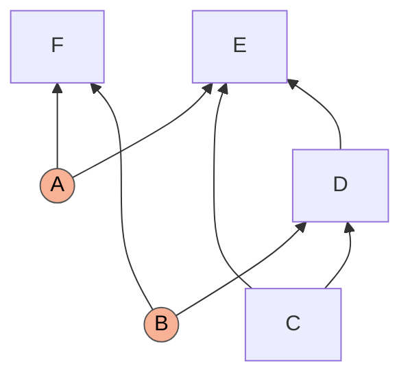
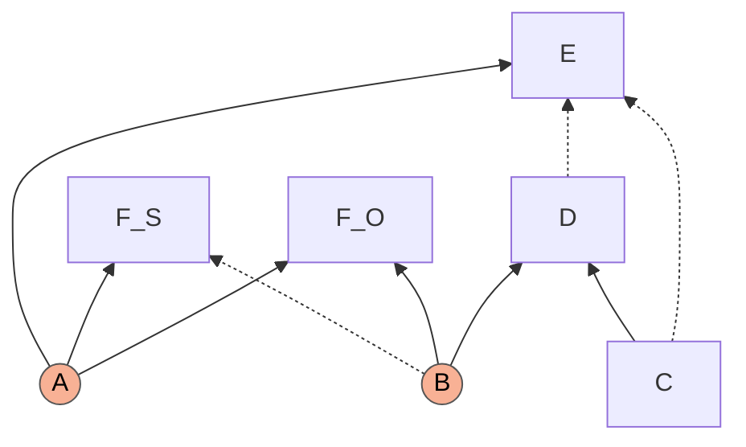
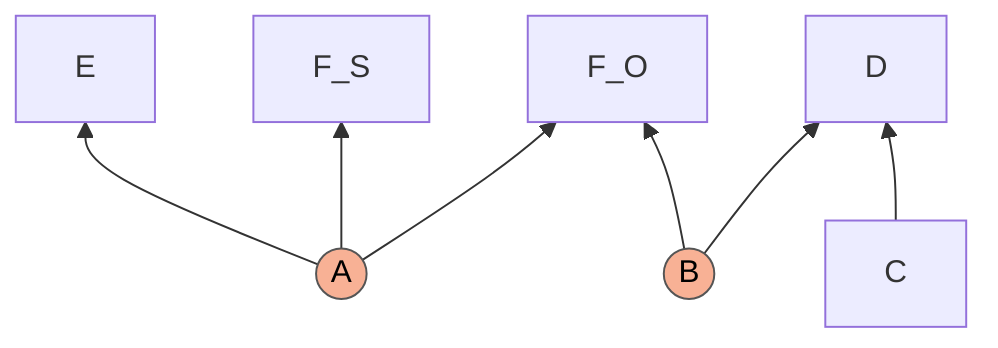
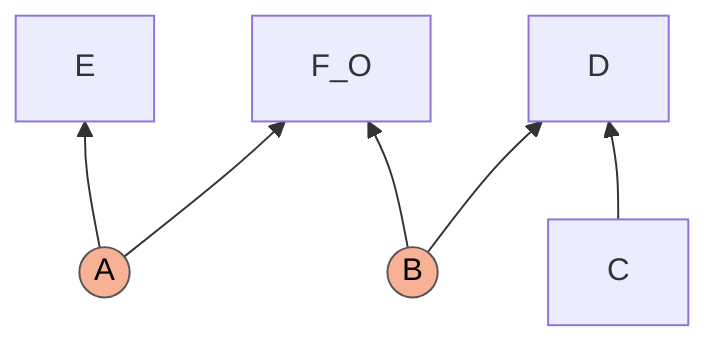
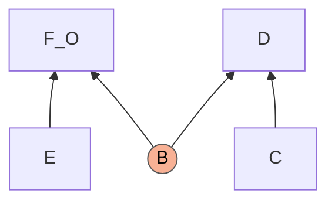
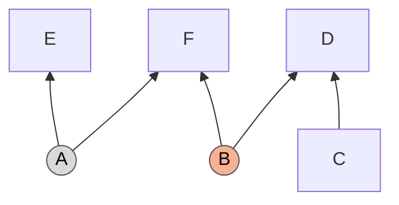

# The KPC structure, step by step: Figure 4 of the draft and the route the code records

*A note for Roger Colbeck and Elie Wolfe. It answers the remark that the step-by-step derivation of Figure 4 of the Khanna–Pusey–Colbeck draft ("Sequence of piggybacks taking $G_1$ to the Bell causal structure") goes through entropically but not with the semigraphoid axioms, and says how that derivation relates to the single step the census records for the same structure. Section numbers such as 7.5 refer to [`piggybacks.md`](piggybacks.md). Every number below is printed by [`Special Applications/kpc_figure4_checks.py`](../Special%20Applications/kpc_figure4_checks.py), which runs in a few seconds.*

## Summary

1. **The first half of the remark is right.** The code goes from the KPC structure to the Bell class in one recorded transition. It never builds the intermediate graphs of Figure 4.
2. **The Corollary 5 step, exactly as Proposition 6 states it, is certified by neither engine.** Its test asks for the Markov conditions of the third graph of Figure 4 *with the original latent $A$*. A three-bit model satisfies every hypothesis and violates them, so no sound method can derive them, entropic or otherwise. Our LP agrees: not implied.
3. **With two amendments the step is certified by both engines.** The latent of the third graph has to be read as a new variable (the value of $E$), and the equality $F_S=E$ has to be used in both directions. Then the LP and the semigraphoid closure both certify it. In all twelve formalisations we tried, the two engines agree.
4. **Where an entropic-versus-semigraphoid difference appears.** The semigraphoid axioms act on conditional independences, and $F_S=E$ is not one. If the closure is given the equality in one direction only (which is what our code does by design), or not at all, the Figure 4 step fails, while an LP that holds $H(F_S\mid E)=H(E\mid F_S)=0$ succeeds on the amended target. That reproduces the observation. It is a difference in what is fed in, not in what the two proof systems can infer.
5. **The code's route needs neither amendment as a separate act.** Its step removes the predicting copy of $F$ inside the same transformation, so the target never mentions $F_S$ and one direction of the equality is enough; the relabelling of $A$ happens inside the certificate.

## 1. The structure and the argument

Observed $C,D,E,F$; latent $A$ (children $E,F$) and $B$ (children $D,F$); edges $C\to D$, $C\to E$, $D\to E$. In the code's labels $F=0$, $C=1$, $D=2$, $E=3$, and the structure is written `1→2, 1→3, 2→3; Q{0,2}, Q{0,3}`.



The quantum strategy has $F=(F_O,F_S)$ with $F_S=E$, and $E$ independent of $(C,D)$: $E$ is then a setting announced by $A$, and $(E,C)$ are Bell settings for the outcomes $(F_O,D)$ of the source $B$. The classical statement (Lemma 1 of the paper) is that every classical model of $G_1$ with these two properties satisfies Bell's local causality, $P(c\,d\,e\,f_O)=\sum_b Q(b)Q(c)Q(e)Q(d\mid bc)Q(f_O\mid be)$. Note what this formula contains: $B$, and no $A$.

## 2. Figure 4, arrow by arrow

Dashed edges are the ones the next arrow deletes.

**(i) Fritz II: split $F$ into $F_S$ and $F_O$**, both children of $A$ and $B$.



**(ii) Corollary 5 with $F_S=E$ and $\mathcal C=\lbrace P(E\mid CD)=P(E)\rbrace$.** Proposition 6 removes every incoming edge of the two equal nodes except the ones from $A$: $B\to F_S$, $C\to E$, $D\to E$.



**(iii) Marginalize $F_S$.**



**(iv) Equivalence**: a latent whose only other child is a parentless node can be replaced by an edge from that node. This is the Bell structure with settings $E,C$ and outcomes $F_O,D$.



## 3. The route the code records

One transition, a Fritz step with **predictor $F$ in split mode** and **predicted node $E$, unsplit**, certified by the semigraphoid closure (the LP certifies the same step, and the two engines record no disagreement):

```
Fritz(('targets', (3,)), ('target_mode', 'unsplit'), ('deleted', ((1, 2),)), ('predictor', (0,)), ('predictor_mode', 'split'), ('certificate', 'semigraphoid')):
    Children  : {0:[],1:[2,3],2:[3],3:[]}
    Classical : []
    Quantum   : [(0,2),(0,3)]
== known gap QG_Bell_C_C+QG_Bell_C_Edge+QG_Bell_C_EdgeC+QG_Bell_EdgeC_Edge+QG_Bell_EdgeC_EdgeC+QG_Bell_Edge_Edge:
    Children  : {0:[],1:[2],2:[],3:[]}
    Classical : [(0,3)]
    Quantum   : [(0,2)]
    (quantum-equivalent to the class representative)
    Children  : {0:[],1:[],2:[],3:[]}
    Classical : []
    Quantum   : [(0,2),(1,3),(2,3)]
```

In words: $E$ loses $C\to E$ and $D\to E$; the source $A$ becomes classical for $E$ (grey below); nothing else changes.



This output is `1→2; C{0,3}, Q{0,2}`, the seed `QG_Bell_C_Edge`. Its classical two-party source sits on $E$, which has no parent and no other source, so it is interchangeable with a quantum source and with the edge $E\to F$ (the lift of 0.4 and the equivalence rules of 1.0): the output *is* a member of the Bell class and no second step is needed.

What the single transition contains (6.2, 7.3 to 7.6):

* **Split predictor.** $F$ is split into $F$ and a full copy $F'$ with the same parents. The copy does the predicting, $H(E\mid F')=0$. This is the draft's $F_S$; the draft's $F_O$ is $F$ itself.
* **Restrict the predicted node.** $E$ keeps the parents the predictor can see, $\mathrm{Pa}(E)\cap\mathrm{seen}(F')=\lbrace A\rbrace$, and loses $C$, $D$ and its private noise. The predictor keeps all of its parents, $B$ included.
* **Certificate.** Hypotheses: Markov($G_1$); $F'$ is sufficient for $E$; the observable d-separations of the candidate, here $E\perp CD$. Target (`relabel`, 7.4): the Markov conditions of the candidate with $A$ deleted and $E$ made a parent of $A$'s other children. $E$ takes the place of $A$.
* **Remove the copy.** $F'$ is childless, so it is deleted. Because of this, splitting a childless predictor leaves no trace and the code never materialises the five-node structure.

| Figure 4 | The code's transition | What differs |
|---|---|---|
| (i) Fritz II: $F\mapsto(F_S,F_O)$ | split predictor: $F\mapsto(F,F')$ | the copy exists only inside the step |
| (ii) Corollary 5: delete $B\to F_S$, $C\to E$, $D\to E$ | restrict $E$ to $\lbrace A\rbrace$; the predictor keeps $B$ | symmetric against asymmetric treatment of the two equal nodes |
| (iii) marginalize $F_S$ | delete the childless copy $F'$ | nothing |
| (iv) equivalence, $A$ becomes $E\to F_O$ | `relabel` inside the certificate, then the lift | where $A$ is exchanged for $E$ |

## 4. What each engine certifies

The Corollary 5 step is an implication between statements about one joint distribution over $C,D,E,F_S,F_O,A,B$: *Markov(second graph), $E\perp CD$ and $F_S=E$ imply Markov(target)*. The table gives the verdict of the entropic LP (Shannon cone, Mosek) and of the semigraphoid closure for twelve readings of that implication. In the closure a functional dependence $H(s\mid X)=0$ enters as the sufficiency statement "given $X$, $s$ is independent of everything else" (7.3); the equality in both directions is two such statements.

| # | Target | Hypotheses besides Markov | LP | closure |
|---|---|---|---|---|
| 1 | third graph of Figure 4, **given $A$** (Proposition 6 as stated) | $E\perp CD$, $F_S=E$ | no | no |
| 2 | the same | $E\perp CD$ only (Corollary 3 alone) | no | no |
| 3 | third graph with **$A$ replaced by $E$** | $E\perp CD$, $F_S=E$ both directions | **yes** | **yes** |
| 4 | the same | $E\perp CD$, $H(E\mid F_S)=0$ only | no | no |
| 5 | the same | $E\perp CD$, $H(F_S\mid E)=0$ only | no | no |
| 6 | the same | $F_S=E$ only (Fritz I alone) | no | no |
| 7 | the same | $E\perp CD$ only | no | no |
| 8 | code's candidate ($F_S$ keeps $B$), given $A$ | $E\perp CD$, $H(E\mid F_S)=0$ | no | no |
| 9 | code's candidate, $A$ replaced by $E$, $F_S$ still a node | $E\perp CD$, $H(E\mid F_S)=0$ | no | no |
| 10 | the same | $E\perp CD$, $F_S=E$ both directions | **yes** | **yes** |
| 11 | **Bell structure, $F_S$ removed** | $E\perp CD$, $H(E\mid F_S)=0$ | **yes** | **yes** |
| 12 | the same | $E\perp CD$, $F_S=E$ both directions | **yes** | **yes** |

The two engines disagree on no row.

### 4.1 Row 1: the step as stated is false for the given latent

Proposition 6 asks that "$P$ classically compatible with $G$, $P$ satisfies $\mathcal C$ and $P$ has $X_1=X_2$ implies $P$ is classically compatible with $G'$", and proposes to verify it by checking that the hypotheses imply $I(X_i{:}\mathrm{nondesc}_{G'}(X_i)\mid\mathrm{par}_{G'}(X_i))=0$ for every variable, latent or observed, of $G'$. The statement about $P$ is true. The proposed check is not, because it keeps the original $A$ as the witness. Take independent uniform bits $A,B,C$ and

$$D=B\oplus C,\qquad E=A\oplus C\oplus D\ (=A\oplus B),\qquad F_S=A\oplus B,\qquad F_O=(A,B).$$

Every node is a function of its parents in the second graph of Figure 4, $E=F_S$, and $E\perp(C,D)$ because $A$ is uniform and private. Yet in $G'$ the nodes $E$ and $F_S$ are children of $A$ alone, and

$$I(E{:}B,C,D,F_S,F_O\mid A)=1\ \text{bit},\qquad I(F_S{:}B,C,D,E,F_O\mid A)=1\ \text{bit},\qquad I(B{:}A,C,E,F_S)=1\ \text{bit}.$$

These are exactly the three rows on which both engines fail. $E$ is not a function of the given $A$. The observed distribution *is* compatible with $G'$, with a different latent: put $A':=E$. Then $E=F_S=A'$, $F_O$ is a function of $(A',B)$, and all three quantities vanish. This is the difference between the target sets `markov` and `relabel` of 7.4 and 7.5, where the same model appears (in the unsplit form $F=(A,B)$) as the reason `markov` cannot certify the KPC step. If an entropic check of row 1 has passed elsewhere, the two programs differ in something worth finding, since the model above is a counterexample to the implication itself.

### 4.2 Rows 3 to 7: both directions of the equality are needed, and both engines can use them

With $A$ replaced by $E$ the step is certified by both engines (row 3). Remove either direction of the equality and it fails with both (rows 4 and 5). The reason is the third graph itself: $F_S$ is still a node there, and its edge from $B$ has been deleted. Showing that $F_S$ does not depend on $B$ needs $F_S$ to be a function of $E$; showing that $E$ inherits the independences of $F$ needs $E$ to be a function of $F_S$. The caption of Figure 4 says that Corollary 3 and Fritz I cannot be applied one after the other; rows 6 and 7 confirm it for both engines.

This is where a semigraphoid check can fail while an entropic one succeeds. The four semigraphoid rules transform conditional independences, and "$F_S=E$" is not a conditional independence. An LP has it natively as two vanishing conditional entropies. A closure has it only if someone writes in its consequences, the two sufficiency statements; with both written in, the closure reaches the target (row 3). With one (row 4), or with none, since the bare axioms have no way to state it (row 7), it does not. The LP given the full equality on the same target does. So:

* *LP with the equality, closure with one direction or none*: the step "works entropically and not with the semigraphoid axioms". This matches the remark.
* *Both given the same information*: they agree, on every row.

Footnote 6 of the draft wonders whether the graphoid axioms, which need full support, could be replaced by the semigraphoid ones. For this structure they can: wherever the LP certifies a row of the table the closure does too, so neither the intersection axiom nor full support is needed. What no version of the conditional-independence axioms can do without is the equality (rows 2 and 7).

### 4.3 Rows 8 to 12: why the code needs one direction only

The code's Fritz step enters the prediction in one direction, $H(\text{predicted}\mid\text{predictor})=0$, for both of its engines (7.3). Asked to certify a target in which the predicting node is still present, it fails with both engines (rows 8 and 9), and for the same reason as above: $F_S$ may carry more than $E$. Its actual target has the predicting copy removed, and then one direction suffices (row 11). That is the content of Lemma 1: the paper's proof substitutes $e$ for $f_S$ and never needs $F_S$ again.

The same can be seen by running the code on the structure with $F$ split by hand (`QmDAG.split_node`): for the copy as predictor of $E$, and for $F$ as predictor of $E$, both engines return no certificate, and the five-node structure given as an input with only the seeds known is not proven by one Fritz step. Splitting first and predicting afterwards is not a route the code can take; splitting, predicting and discarding the copy in one step is.

## 5. So is there more than one proof?

Not here. Figure 4 and the code's transition are the same argument, cut at different places: the same quantum strategy, the same use of $E\perp CD$, the same final exchange of $A$ for $E$. The differences are bookkeeping, and they matter only when each arrow has to be certified on its own:

| | Figure 4 | Code |
|---|---|---|
| the two equal nodes | treated alike: both lose every parent but $A$ | predictor and predicted: only the predicted node loses parents |
| equality used | both directions | $H(E\mid F')=0$ only |
| the predicting node | survives step (ii), marginalized in (iii) | removed inside the step |
| $A\mapsto E$ | last arrow, as a graph equivalence | inside the certificate (`relabel`) |
| intermediate graphs that must be causal structures for the same distribution | three | none |

For the KPC class the census has exactly one useful route. The steps beyond d-separation that the closure certifies on the KPC structure are $E$ predicted by $F$ (the route above; with $F$ unsplit the step is certified too but deletes $F$ and leaves nothing) and $F$ predicted by $E$, whose output has no quantum source. Other classes do have genuinely different routes depending on which node is split: the class of 6.10 is proven by d-separation with a split target and a split childful predictor, and independently by the closure with a split childless predictor (7.8).

## 6. What would make Figure 4 go through as drawn

1. In the third and fourth graphs, read the common parent of $E$, $F_S$ and $F_O$ as a new latent $A'$ whose value is $E$, not as the original $A$; equivalently, test the Markov conditions of the graph with $E$ in the place of $A$. Proposition 6's condition 1 is then true and checkable.
2. Either use $F_S=E$ in both directions, as two vanishing conditional entropies in an LP or as two sufficiency statements in a semigraphoid closure, or merge arrows (ii) and (iii), so that $F_S$ is gone before anything is asked of it; then $H(E\mid F_S)=0$ alone is enough.

## 7. Reproducing

```
python "Special Applications/kpc_figure4_checks.py"
```

Part 1 prints the twelve rows with the failing Markov statements of each, Part 2 the entropies of the three-bit model, Part 3 the code's own certificates on the KPC structure and on the hand-split structure, and the recorded certificate. The LP column needs Mosek; without it the script prints the closure column alone.
