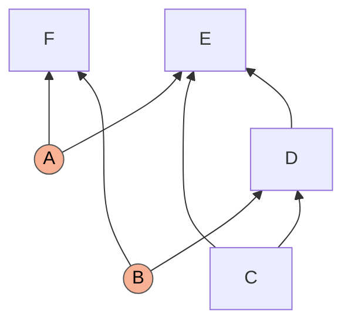
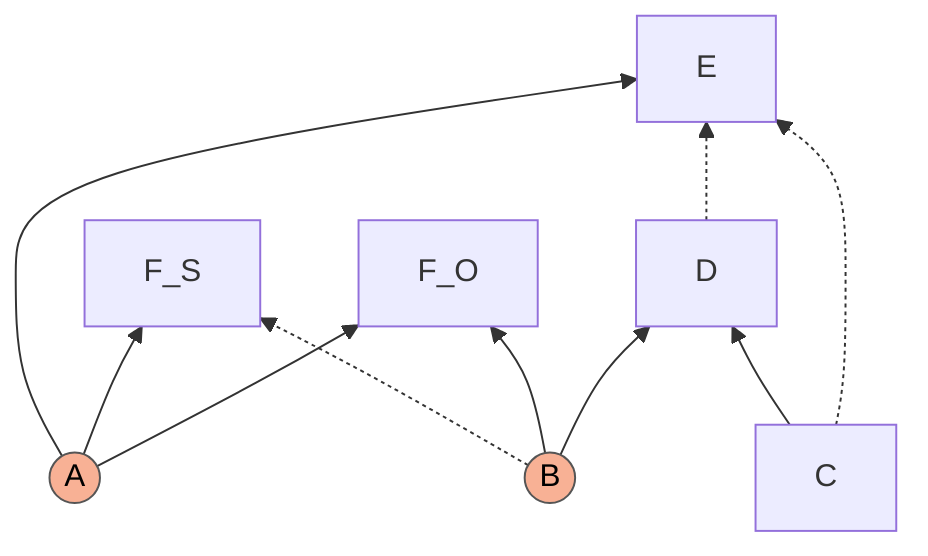
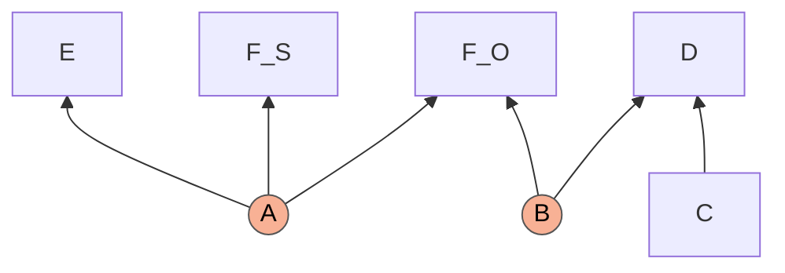
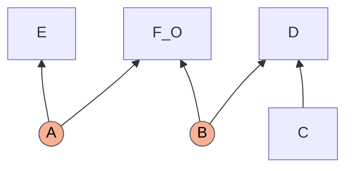
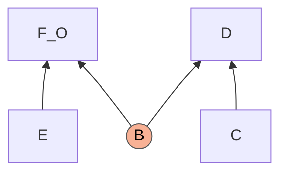
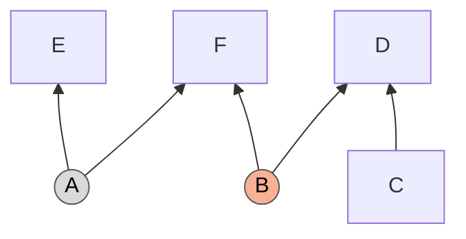
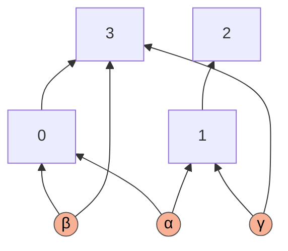
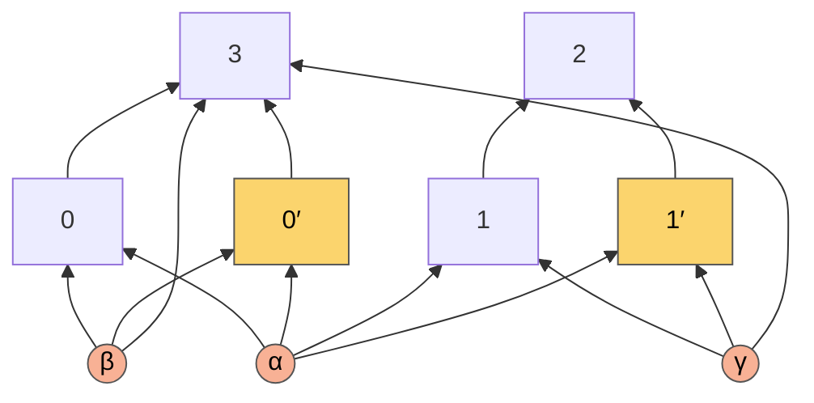
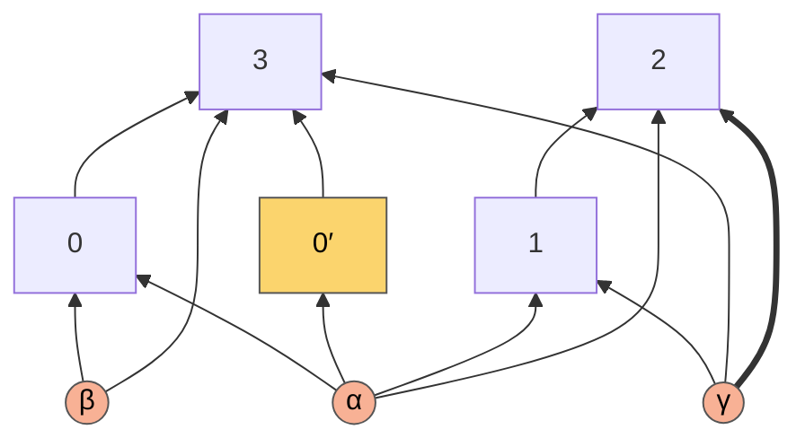
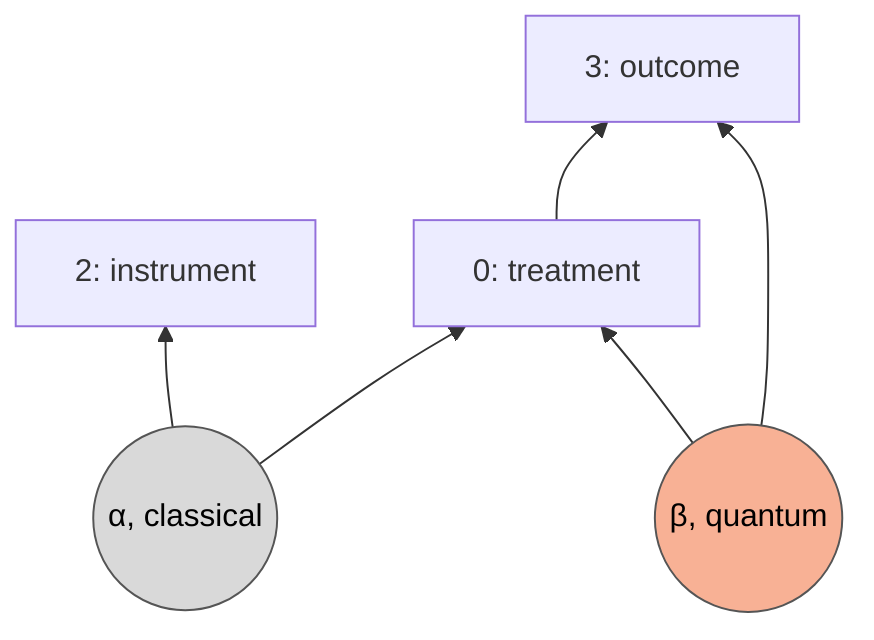

# The KPC structure, step by step: Figure 4 of the draft and the route the code records

A note for Roger Colbeck and Elie Wolfe. It answers the remark that the step-by-step derivation of Figure 4 of the Khanna–Pusey–Colbeck draft (the "sequence of piggybacks" that takes the structure $G_1$ to the Bell causal structure) goes through entropically but not with the semigraphoid axioms, and it says how that derivation relates to the single step our code records for the same structure. Section numbers such as 7.5 refer to [`piggybacks.md`](piggybacks.md). Every number below is printed by [`Special Applications/kpc_figure4_checks.py`](../Special%20Applications/kpc_figure4_checks.py); see Section 9.

## Short answers

1. **Does the code go directly to Bell?** Yes. It records one step from $G_1$ to the Bell structure and never builds the intermediate graphs of Figure 4.
2. **Is that a different proof?** No. It is the same argument cut differently, and one difference accounts for everything: Figure 4 uses $F_S=E$ as an **equality**, each node a function of the other, and deletes arrows into both nodes; the code uses only that $F$ **predicts** $E,$ and deletes arrows into $E$ alone. A graph that still contains $F_S$ as a node needs the equality. The code discards the predicting part of $F$ inside the step, so it never has such a graph (Section 4).
3. **Does the Corollary 5 step hold entropically and fail with the semigraphoid axioms?** We cannot reproduce a difference. An equality is entered into a semigraphoid as two statements, "given $F_S,$ $E$ is independent of everything else" and the same with the roles exchanged. With both entered, the semigraphoid test certifies the step exactly when the entropic test does. A semigraphoid test that was given one of the two statements, or neither, fails. So a difference between the two tests on this step is a difference in what they were told (Section 5.1).
4. **One correction to the step as written.** Proposition 6 tests the Markov conditions of the third graph of Figure 4 with the original latent $A.$ That implication is false: a three-bit model satisfies every hypothesis and violates the conclusion, and our entropic test rejects it too. The common parent in the third graph has to be read as a new latent whose value is $E$ (Section 5.2).
5. **Why does the code not use the equality?** It would certify no additional step: across all four-node structures both premises certify the same 2,491 of 4,482 candidate steps. The one new thing the equality permits is to delete the arrows into the second node as well, and that is harmless only when that node has no children, as $F_S$ here. When it has children, the result can have a quantum-classical gap that the starting structure does not have, and no test notices (Section 6 and the appendix).

## 1. The structure, and what a proof of this kind has to show

Observed $C,D,E,F;$ latent $A$ (children $E,F$) and $B$ (children $D,F$); edges $C\to D,$ $C\to E,$ $D\to E.$ In the code's labels $F=0,$ $C=1,$ $D=2,$ $E=3,$ and the structure is written `1→2, 1→3, 2→3; Q{0,2}, Q{0,3}`: the edges, then the sources, each named by the nodes that share it (`Q` quantum, `C` classical).



Both routes below reduce the question "does $G_1$ have a quantum-classical gap?" to the same question about a structure where the answer is known, here Bell's. Every such reduction has two halves, and we name them in full throughout.

* **The quantum direction.** Every quantum distribution of the known structure can be produced by a quantum model of $G_1,$ in a form that has some extra observable property. Here: let $F$ output a pair $(F_O,F_S)$ with $F_S=E,$ and let $E$ be independent of $(C,D).$ Then $E$ is a setting announced by the source $A,$ and $(E,C)$ are Bell settings for the outcomes $(F_O,D)$ of the source $B.$
* **The classical direction.** If a distribution with that property were classical in $G_1,$ the corresponding distribution would be classical in the known structure. Here (Lemma 1 of the paper): every classical model of $G_1$ with $F_S=E$ and $E$ independent of $(C,D)$ satisfies Bell's local causality,

```math
P(c\,d\,e\,f_O)=\sum_b Q(b)\,Q(c)\,Q(e)\,Q(d\mid bc)\,Q(f_O\mid be).
```

Together: a quantum Bell violation, produced inside $G_1$ in that form, cannot be classical in $G_1.$ Figure 4 and the code agree on the quantum direction. They differ in how the classical direction is cut into steps and tested. Note what the formula contains: $B,$ and no $A.$

## 2. Figure 4, arrow by arrow

Dashed edges are the ones the next arrow deletes.

**(i) Fritz II: split $F$ into $F_S$ and $F_O$**, both children of $A$ and $B.$



**(ii) Corollary 5 with $F_S=E$ and $\mathcal C=\lbrace P(E\mid CD)=P(E)\rbrace.$** Proposition 6 removes every incoming edge of the two equal nodes except the ones from $A$: $B\to F_S,$ $C\to E,$ $D\to E.$



**(iii) Marginalize $F_S.$**



**(iv) Equivalence**: a latent whose only other child is a parentless node can be replaced by an edge from that node. This is the Bell structure with settings $E,C$ and outcomes $F_O,D.$



## 3. The code's single step

The code records one step, of the kind the manuscript calls a Fritz step: **$F$ predicts $E$**. It is certified by the semigraphoid test; the entropic test certifies it too.

```
Fritz(('targets', (3,)), ('target_mode', 'unsplit'), ('deleted', ((1, 2),)), ('predictor', (0,)), ('predictor_mode', 'split'), ('certificate', 'semigraphoid')):
    Children  : {0:[],1:[2,3],2:[3],3:[]}
    Classical : []
    Quantum   : [(0,2),(0,3)]
== known gap QG_Bell_C_C+QG_Bell_C_Edge+QG_Bell_C_EdgeC+QG_Bell_EdgeC_Edge+QG_Bell_EdgeC_EdgeC+QG_Bell_Edge_Edge:
    Children  : {0:[],1:[2],2:[],3:[]}
    Classical : [(0,3)]
    Quantum   : [(0,2)]
    (quantum-equivalent to the class representative)
    Children  : {0:[],1:[],2:[],3:[]}
    Classical : []
    Quantum   : [(0,2),(1,3),(2,3)]
```

In words: $E$ loses $C\to E$ and $D\to E;$ the source $A$ becomes classical for $E$ (grey below); nothing else changes.



This output is `1→2; C{0,3}, Q{0,2}`. Its classical source is shared with $E,$ which has no parent and no other source. Such a source does the same work as the edge $E\to F$: this is arrow (iv) of Figure 4 read backwards. So the output is the Bell structure, with settings $E,C$ and outcomes $F,D,$ and no second step is needed.

What the single step contains (6.2, 7.3 to 7.6 of the manuscript):

* **A predicting copy.** $F$ is treated as itself plus a copy $F'$ with the same parents. The copy does the predicting, $H(E\mid F')=0.$ It is the draft's $F_S;$ the draft's $F_O$ is $F$ itself.
* **The predicted node is restricted.** $E$ keeps the parents the predictor can see, here $A$ alone, and loses $C,$ $D$ and its private noise. The predictor keeps all of its parents, $B$ included.
* **The test of the classical direction.** Hypotheses: the Markov conditions of $G_1;$ $F'$ determines $E;$ and $E\perp CD.$ Conclusion: the Markov conditions of the restricted graph, with $E$ in the place of $A$ as the parent of the other children of $A.$
* **The copy is discarded.** $F'$ has no children, so it is deleted. A discarded childless copy leaves no trace, which is why the code never shows a five-node structure.

## 4. The one difference: equality or prediction

Both routes use the quantum strategy $F=(F_O,F_S)$ with $F_S=E.$ They differ in how much of that equality the classical direction is allowed to use.

| | Figure 4 (Corollary 5) | The code |
|---|---|---|
| premise | $F_S=E$: $H(E\mid F_S)=0$ and $H(F_S\mid E)=0$ | $F$ predicts $E$: $H(E\mid F)=0$ |
| roles | two equal nodes, treated alike | a predictor and a predicted node |
| arrows deleted | into both nodes: $C\to E,$ $D\to E$ and $B\to F_S$ | into the predicted node only: $C\to E,$ $D\to E$ |
| the predicting part of $F$ | split off as the node $F_S,$ kept, marginalized by the next arrow | never a node of the result: discarded inside the step |
| the exchange of $A$ for $E$ | the last arrow, as a graph equivalence | inside the test of the step |
| intermediate graphs, each of which must be a causal structure for the same distribution | three | none |

What each half of the equality buys:

* $H(E\mid F_S)=0,$ the copy determines $E.$ It lets $E$ inherit the independences of $F,$ and that deletes $C\to E$ and $D\to E.$
* $H(F_S\mid E)=0,$ $E$ determines the copy. It says that the copy carries nothing beyond $E.$ That is what deletes $B\to F_S,$ and it is needed for **any** graph that keeps $F_S$ as a node: without it $F_S$ may carry more of $A$ and $B$ than $E$ does, and then it stays correlated with $F_O$ given its new parents.

So the question "why does Figure 4 pass through an intermediate graph and the code not" has a short answer. Corollary 5 holds the second half, and its third graph, with $F_S$ present and its arrow from $B$ deleted, cannot be had without it. The code asks nothing of $F_S$ as a node: the copy is gone before the conclusion is tested, and then the first half is all that is needed. The table of Section 5 shows this on $G_1$ (rows 3, 4 and 5; rows 9 and 10; row 11). It holds at large as well: among the 2,491 candidate steps that are certified on the four-node structures, the graph of the Corollary 5 shape, with both nodes restricted, is certified in all 2,491 when both halves are given and in 540 when one is.

## 5. What the two tests certify

The Corollary 5 step is an implication between statements about one joint distribution over $C,D,E,F_S,F_O,A,B$: the Markov conditions of the second graph, $E\perp CD$ and $F_S=E$ together imply the Markov conditions of the target graph. We put twelve readings of it to two tests.

* **The entropic test** is a linear program over entropy vectors: it asks whether the hypotheses, with all the Shannon inequalities, force every conditional mutual information of the conclusion to vanish.
* **The semigraphoid test** starts from the conditional independences among the hypotheses and closes them under the semigraphoid rules; it asks whether the conclusion is in the closure.

| # | Target | Hypotheses besides Markov | entropic | semigraphoid |
|---|---|---|---|---|
| 1 | third graph of Figure 4, **given $A$** (Proposition 6 as stated) | $E\perp CD,$ $F_S=E$ | no | no |
| 2 | the same | $E\perp CD$ only (Corollary 3 alone) | no | no |
| 3 | third graph with **$A$ replaced by $E$** | $E\perp CD,$ $F_S=E$ both directions | **yes** | **yes** |
| 4 | the same | $E\perp CD,$ $H(E\mid F_S)=0$ only | no | no |
| 5 | the same | $E\perp CD,$ $H(F_S\mid E)=0$ only | no | no |
| 6 | the same | $F_S=E$ only (Fritz I alone) | no | no |
| 7 | the same | $E\perp CD$ only | no | no |
| 8 | code's candidate ($F_S$ keeps $B$), given $A$ | $E\perp CD,$ $H(E\mid F_S)=0$ | no | no |
| 9 | code's candidate, $A$ replaced by $E,$ $F_S$ still a node | $E\perp CD,$ $H(E\mid F_S)=0$ | no | no |
| 10 | the same | $E\perp CD,$ $F_S=E$ both directions | **yes** | **yes** |
| 11 | **Bell structure, $F_S$ removed** | $E\perp CD,$ $H(E\mid F_S)=0$ | **yes** | **yes** |
| 12 | the same | $E\perp CD,$ $F_S=E$ both directions | **yes** | **yes** |

The two tests disagree on no row.

### 5.1 Is there a difference between the entropic and the semigraphoid test?

Not on this step. It is worth saying exactly why the question arises and what the answer rests on.

**How an equality enters a semigraphoid.** The semigraphoid rules act on statements of one form: $X$ is independent of $Y$ given $Z.$ That $E$ is a function of $F_S$ is not of that form, so it has to be translated, and the translation is natural: given $F_S,$ the node $E$ is independent of **every other variable**. The equality $F_S=E$ is two such statements, one in each direction. This is how our semigraphoid test receives it (7.3).

**With both statements entered, the two tests agree.** Rows 3, 10 and 12 are certified by both, and every other row is rejected by both. So the remark that the step "works entropically and not with the semigraphoid axioms" cannot be a fact about the two proof systems on this step. It can only come from what each test was given. We cannot see the computation behind the remark, but the table shows which inputs produce it:

* **Neither statement was entered** (row 7). This is the likeliest reading. The draft defines the equality for entropy vectors only, by equating entropies, and its graphoid version (Corollary 4) takes conditional independences among observed nodes and nothing else. Equating entropies does more than it seems to: every statement that mentions both equal nodes then follows by arithmetic. For example

```math
I(F_S : B \mid E) \;=\; H(F_S,E)+H(B,E)-H(F_S,B,E)-H(E) \;=\; H(E)+H(B,E)-H(B,E)-H(E) \;=\; 0 .
```

  A semigraphoid has no arithmetic. A statement that mentions both $F_S$ and $E$ exists in it only if someone writes it in.
* **Or one of the two was entered** (rows 4 and 5).

In either case an entropic test holding the full equality succeeds on the amended target and the semigraphoid test fails. Given the same information, they agree.

**Are the two tests equally strong in general?** No, and for completeness: the entropic test is stronger in principle, in two ways that do not matter here.

* The Shannon inequalities prove implications among conditional independences that no chain of semigraphoid steps proves. The smallest example has four variables. Because of the identity

```math
I(A:B\mid CD)+I(C:D\mid A)+I(C:D\mid B)+I(A:B) \;=\; I(C:D\mid AB)+I(A:B\mid C)+I(A:B\mid D)+I(C:D),
```

  the four independences on the left imply the four on the right. Our entropic test derives them; our semigraphoid test derives none of them.
* The statement the semigraphoid holds, "given $X,$ $s$ is independent of everything else", follows from $H(s\mid X)=0$ and is weaker than it.

Neither gap has shown up in practice. In the census of four-node structures the two tests are run side by side on every candidate step that needs them, and they have never disagreed.

Footnote 6 of the draft asks whether the graphoid axioms, which need full support, could be replaced by the semigraphoid ones. For this structure they can: wherever the entropic test certifies a row the semigraphoid test does too, so neither the intersection axiom nor full support is needed. What no version of the axioms can do without is the equality, entered explicitly (rows 2 and 7).

### 5.2 Row 1: with the original latent, the step as written is false

Proposition 6 asks that a distribution $P$ which is classically compatible with $G,$ satisfies $\mathcal C$ and has $X_1=X_2$ be classically compatible with $G',$ and proposes to verify this by checking that the hypotheses imply, for every variable $X_i$ of $G',$ latent or observed,

```math
I\bigl(X_i : \mathrm{nondesc}_{G'}(X_i) \mid \mathrm{par}_{G'}(X_i)\bigr)=0 .
```

The statement about $P$ is true. The proposed check is not, because it keeps the original $A$ as the witness. Take independent uniform bits $A,B,C$ and

```math
D=B\oplus C,\qquad E=A\oplus C\oplus D\ (=A\oplus B),\qquad F_S=A\oplus B,\qquad F_O=(A,B).
```

Every node is a function of its parents in the second graph of Figure 4, $E=F_S,$ and $E\perp(C,D)$ because $A$ is uniform and private. Yet in $G'$ the nodes $E$ and $F_S$ are children of $A$ alone, and

```math
I(E : B,C,D,F_S,F_O\mid A)=1\ \text{bit},\qquad I(F_S : B,C,D,E,F_O\mid A)=1\ \text{bit},\qquad I(B : A,C,E,F_S)=1\ \text{bit}.
```

These are exactly the three statements on which both tests fail in row 1. $E$ is not a function of the given $A.$ The observed distribution *is* compatible with $G',$ with a different latent: put $A':=E.$ Then $E=F_S=A',$ $F_O$ is a function of $(A',B),$ and all three quantities vanish. Because the model above is a genuine distribution, no correct entropic test can accept row 1. If one has, the two programs differ in something worth finding.

### 5.3 Rows 8 to 12: why one half of the equality is enough for the code

The code gives its tests the prediction in one direction only, the predictor determines the predicted node. Asked for a conclusion in which the predicting node is still present, it fails with both tests (rows 8 and 9), for the reason of Section 4: $F_S$ may carry more than $E.$ Its actual conclusion has the predicting copy removed, and then one direction suffices (row 11). That is the content of Lemma 1: the paper's proof substitutes $e$ for $f_S$ and never needs $F_S$ again.

The same can be seen by running the code on the structure with $F$ split by hand: with the copy as predictor of $E,$ or with $F$ as predictor of $E,$ both tests refuse. Splitting first and predicting afterwards is not a route the code can take. Splitting, predicting and discarding the copy in one step is.

## 6. Why the code uses prediction and not the equality

Suppose the search were rebuilt on the equality of two nodes. Three things would change.

**The predictor would always have to be split first.** An equality needs a node whose value is exactly that of the predicted node, so the predictor must be split into that part and the rest, as $F$ into $F_S$ and $F_O.$ The predicted node needs no split for this; then as now, it is split only when its original has to survive in the result. With prediction, a predictor that has no children, or one that is removed anyway, needs no split at all: the node as it stands, $F=(F_O,F_S),$ determines $E$ without being equal to it. Prediction is the weaker premise. A step proven from it applies wherever the equality holds and also where it does not, and it works on one node fewer. Fritz's original argument for the triangle is of this kind: one node predicts two others at once and is equal to neither.

**No additional step would be certified.** For every four-node structure and every pair of predictor and predicted node the search tries, we split the predictor into an explicit copy and gave the semigraphoid test the equality in both directions.

| | candidate steps | certified by the code, from prediction | certified from the equality | certified from prediction when the copy must remain a node |
|---|---|---|---|---|
| the 46 open classes | 504 | 184 | 184, the same ones | 162 |
| all 418 classes | 4,482 | 2,491 | 2,491, the same ones | 2,280 |

The second half of the equality certifies no step that the first half does not. It is needed only to keep the copy as a node, which the code never does.

**The one new thing the equality permits is either pointless or unsound.** With the equality one may delete the arrows into the second node too, as Corollary 5 does. After that the two equal nodes are duplicates, and one of them is removed.

* If the removed node has **no children**, the extra deletion changed nothing: the node disappears, and the result is the same structure the code produces. This is the case of $F_S$ in Figure 4.
* If the removed node **has children**, they inherit its parents, and after the extra deletion they inherit fewer. The result can then have a quantum-classical gap although the starting structure has none. The appendix works through an example: a structure with no gap is sent to one that contains the instrumental scenario.

All three tests accept the extra deletion in that example: d-separation, the semigraphoid test and the entropic test. They are right to, because they examine the classical direction, and the classical direction is true. What fails is the quantum direction, which no test examines: the gap of the result is witnessed by a distribution that cannot be produced in the starting structure with the two nodes equal.

The code's rule avoids this by keeping the roles apart. The predicted node loses arrows. The predicting node loses none, and when it is removed its children inherit everything it could see. As a check on the code's own rule: on the 20 four-node classes that provably have no gap, its 42,962 steps of this kind produce 4,023 distinct results, and none of them reaches a structure with a known gap.

None of this touches Figure 4. There $F_S$ is childless, the two ways of deleting coincide, and the gap is established for an explicit quantum strategy in which the equality holds. The difference matters for a search that has to apply the step blindly to 996 structures and then look the result up in a list of known gaps.

## 7. One proof or two?

One. Figure 4 and the code's step are the same argument: the same quantum strategy, the same use of $E\perp CD,$ the same final exchange of $A$ for $E.$ The differences are those of the table in Section 4, and they matter only when each arrow has to be tested on its own.

For $G_1$ the search finds exactly one useful route. The steps beyond d-separation that the semigraphoid test certifies on it are $E$ predicted by $F$ (the route above) and $F$ predicted by $E,$ whose result has no quantum source. Other structures do have different routes depending on which node is split: the example of 6.10 in the manuscript is proven in two independent ways (7.8).

## 8. What would make Figure 4 go through as drawn

1. In the third and fourth graphs, read the common parent of $E,$ $F_S$ and $F_O$ as a new latent $A'$ whose value is $E,$ not as the original $A;$ equivalently, test the Markov conditions of the graph with $E$ in the place of $A.$ Condition 1 of Proposition 6 is then true and checkable.
2. Give the test $F_S=E$ in both directions: as two vanishing conditional entropies in the entropic test, or as the two statements of Section 5.1 in a semigraphoid test. Or merge arrows (ii) and (iii), so that $F_S$ is gone before anything is asked of it; then $H(E\mid F_S)=0$ alone is enough.

## 9. Reproducing

```
python "Special Applications/kpc_figure4_checks.py"
python "Special Applications/kpc_figure4_checks.py" --census
```

The first command takes a few seconds. Part 1 prints the twelve rows with the statements on which each fails, and the four-variable example of Section 5.1; Part 2 the entropies of the three-bit model; Part 3 the code's own verdicts on $G_1$ and on the hand-split structure, and the recorded step. The entropic column needs Mosek; without it the script prints the semigraphoid column alone. With `--census` (five minutes) Part 4 prints the comparison of prediction with equality across all structures, and Part 5 the example of the appendix, the verdicts of the three tests on it, and the check of the code's own rule.

## Appendix. Deleting arrows into both equal nodes: what goes wrong

This appendix is self-contained. It shows, on the smallest example we found, why a search may not delete the arrows into both of two perfectly correlated nodes, even though every available test approves.

### A.1 What has to hold

We want a rule that turns a structure $G$ into a structure $G'$ such that **if $G'$ has a quantum-classical gap, so does $G$**, for any gap of $G'$ whatsoever, because the search only knows that $G'$ is on a list of structures with a gap. As in Section 1, that needs two things.

* **The quantum direction.** Whatever quantum distribution of $G'$ exhibits the gap, a quantum model of $G$ can produce it, in the form the rule assumes. For the rule examined here, that form is: two particular nodes are perfectly correlated.
* **The classical direction.** If a distribution of that form were classical in $G,$ the corresponding distribution would be classical in $G'.$

The tests, d-separation, semigraphoid and entropic, are tests of the classical direction. The quantum direction is supposed to hold by the way the rule is built. In the example below the classical direction holds, all three tests say so, and the quantum direction fails.

### A.2 A structure with no gap

Four nodes, 0 to 3. Three quantum sources: $\alpha$ shared by 0 and 1, $\beta$ shared by 0 and 3, $\gamma$ shared by 1 and 3. Two edges, 0→3 and 1→2. In the code's notation, `0→3, 1→2; Q{0,1}, Q{0,3}, Q{1,3}`.



It has no gap. Classically, nodes 0, 1 and 3 can have any joint distribution: node 0 takes its value from $\alpha;$ node 3 computes its value from node 0 and $\gamma;$ node 1 holds both $\alpha$ and $\gamma,$ so it can recompute the other two values and then choose its own. Node 2 sees node 1 and nothing else. So every distribution in which node 2 is independent of nodes 0 and 3 given node 1 is classical here, and every quantum distribution of this structure has that independence too. Quantum and classical coincide.

### A.3 The step: node 1 predicts node 0

Split node 1 into itself and a copy 1′, and node 0 into itself and a copy 0′. A copy has the same parents and the same children as its original. The premise of the step is that **1′ and 0′ are perfectly correlated**.



The two copies (yellow) share exactly one parent, $\alpha.$ Two rules can now be applied.

| | deletes | then removes 1′, whose child is node 2 | so node 2 inherits |
|---|---|---|---|
| **the code's rule** (1′ predicts 0′) | the arrows into 0′ other than from $\alpha$: here $\beta\to$ 0′ | 1′ still has both its parents | $\alpha$ and $\gamma$ |
| **the rule under examination** (1′ equals 0′) | the same, and also the arrows into 1′ other than from $\alpha$: here $\gamma\to$ 1′ | 1′ has one parent left | $\alpha$ only |

In both results the restricted nodes and the inheriting node hold $\alpha$ as a classical source: they receive a classical value from it, not a quantum share.

### A.4 The two results

The code's rule gives `0→3, 1→2, 4→3; C{0,1,2,4}, C{1,2,3}, Q{0,1}, Q{0,3}, Q{1,3}`, with 0′ renamed 4. The thick arrow is the one the other rule does not have.



The rule under examination gives `0→3, 1→2, 4→3; C{0,1,2,4}, Q{0,1}, Q{0,3}, Q{1,3}`: the same picture without the thick arrow. Node 2 now holds a classical share of $\alpha$ and nothing of $\gamma.$

That second result has a gap. Let nodes 1 and 0′ output constants. What remains is



the instrumental scenario: an instrument correlated with the treatment, a treatment that acts on the outcome, a quantum source shared by treatment and outcome, and no other link from instrument to outcome. Its quantum-classical gap is known. So the rule under examination has turned a structure without a gap into a structure with one. It is not a valid rule.

The first result has no such sub-scenario. There node 2 also holds a share of $\gamma,$ which node 3 holds as well, so the instrument and the outcome share a source and the instrumental inequality does not apply. The search finds no known gap in it, as it must not.

### A.5 Which half failed

**The classical direction is fine.** If a classical model of the split structure has 1′ equal to 0′, then the value of 1′ is a function of what it shares with 0′, which is $\alpha,$ so the arrow from $\gamma$ into 1′ is idle and may be deleted. All three tests confirm it:

| test of "both nodes may be restricted to $\alpha$" | verdict |
|---|---|
| d-separation, with 1′ as the predictor of 0′ | accepted |
| d-separation, with 0′ as the predictor of 1′ | accepted |
| semigraphoid test, given the equality in both directions | accepted |
| entropic test, given the equality in both directions | accepted |
| either of the last two, given one direction only | rejected |

So this is not a weakness of the d-separation version of the rule that a finer test would repair. The semigraphoid and entropic tests give the same false positive, because the statement they are asked about is true.

**The quantum direction fails.** The gap of the second result is exhibited by the distribution of A.4: node 2 announces the classical value $\lambda$ of $\alpha,$ node 0 uses $\lambda$ as its measurement setting, and nodes 1 and 0′ are constant. To transfer that gap, the starting structure would have to produce this distribution with 1′ equal to 0′. It cannot. In the starting structure node 2 has a single parent, node 1, whose output after the split is the pair (1, 1′). In the distribution above the component 1 is constant, so $\lambda$ can reach node 2 only through the component 1′. Then 1′ carries $\lambda$ while 0′ is constant: they are not equal. The premise fails for the very distribution that exhibits the gap, and the classical direction, which was proven under that premise, says nothing about it.

Put differently: after the extra deletion, node 2 owes its knowledge of $\alpha$ to a node that was assumed to carry only the value of 0′. A copy cannot both carry only that value and pass the source on.

**Why the code's rule is immune.** It never asks 1′ to equal anything, only to determine 0′. A copy that passes on everything it sees and, in addition, announces the value of 0′ does that. So every quantum distribution of the code's result can be produced in the starting structure with the premise holding, which is the quantum direction. The price is that node 2 inherits everything 1′ could see, $\gamma$ included, and with $\gamma$ the instrumental argument is gone, as it should be.

### A.6 When deleting into both nodes is harmless

* When the node that is removed has **no children**. Nothing inherits from it, the two rules give the same result, and the question does not arise. This is Figure 4: $F_S$ is childless.
* When the gap of the result is not looked up but **established for an explicit strategy in which the two nodes are equal**, as the KPC paper does. Then the quantum direction is verified by hand for that strategy.

What is not safe is the combination a search needs: delete into both nodes, remove one that has children, and conclude from the mere fact that the result is on a list of structures with a gap.
