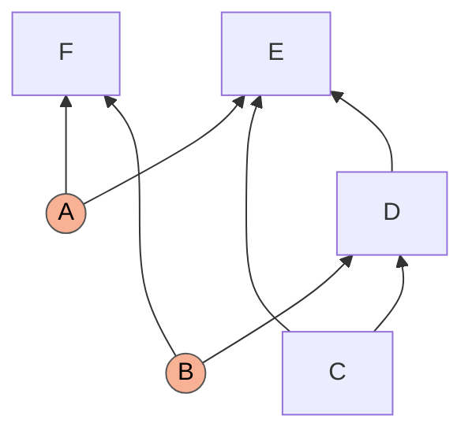
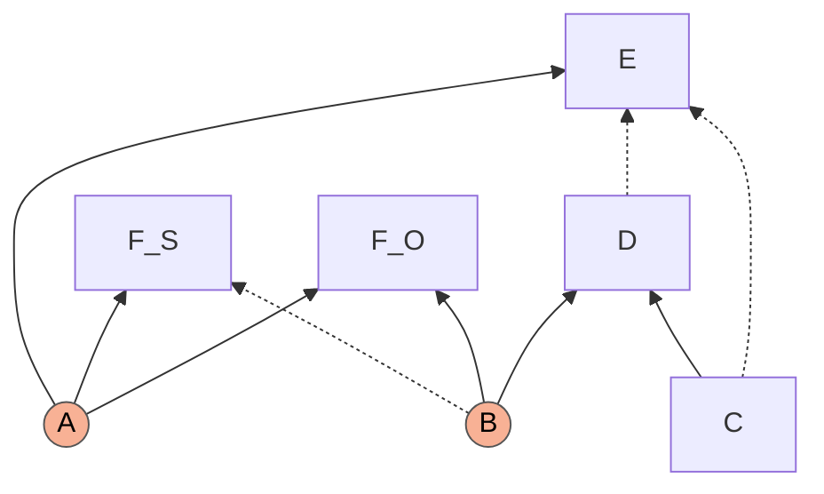
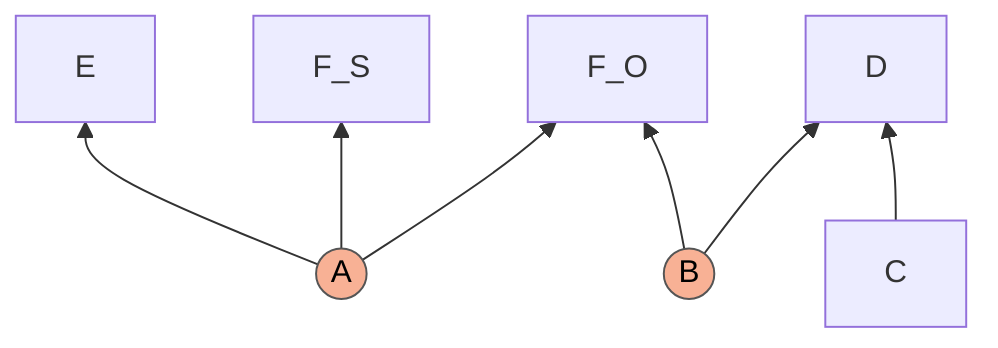
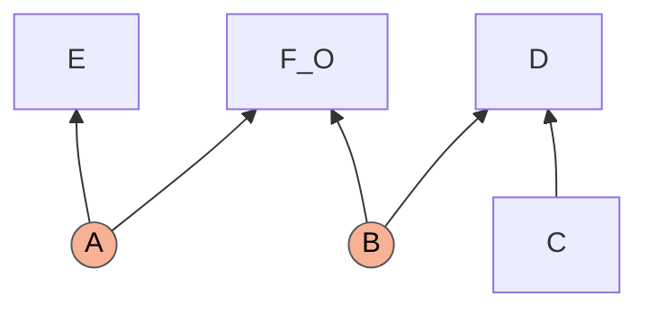
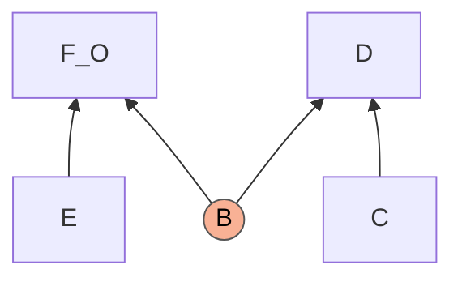
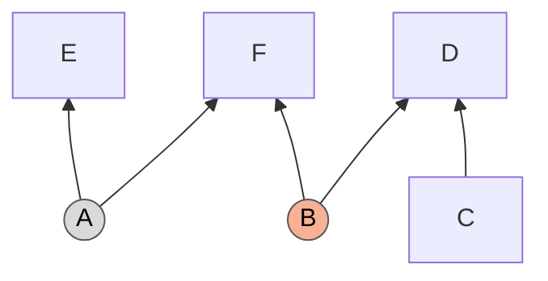
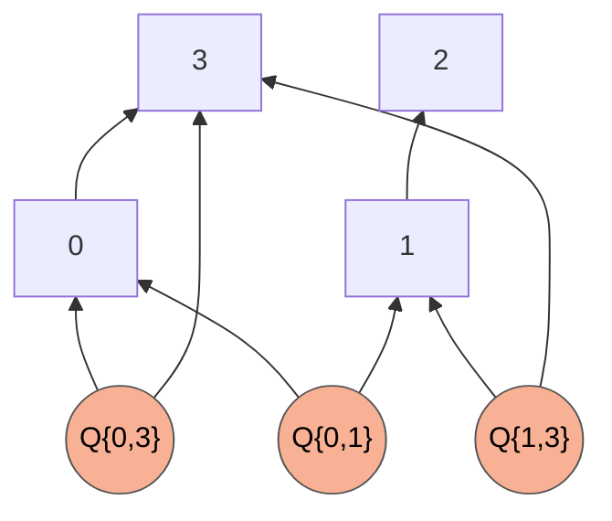
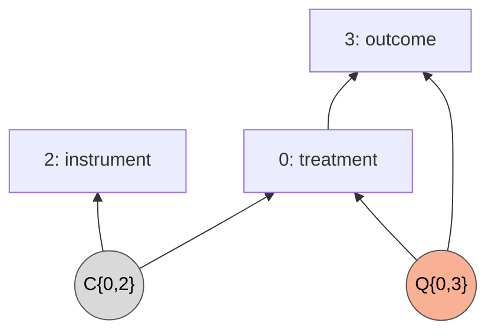

# The KPC structure, step by step: Figure 4 of the draft and the route the code records

A note for Roger Colbeck and Elie Wolfe. It answers the remark that the step-by-step derivation of Figure 4 of the Khanna–Pusey–Colbeck draft (the "sequence of piggybacks" that takes the structure $G_1$ to the Bell causal structure) goes through entropically but not with the semigraphoid axioms, and it says how that derivation relates to the single step the census records for the same structure. Section numbers such as 7.5 refer to [`piggybacks.md`](piggybacks.md). Every number below is printed by [`Special Applications/kpc_figure4_checks.py`](../Special%20Applications/kpc_figure4_checks.py); see Section 9.

## Summary

1. **One difference explains the two routes: equality against prediction.** Figure 4 uses $F_S=E$ as an equality, each node a function of the other, and deletes arrows into both nodes at once (Corollary 5). The code uses one direction only, that $F$ predicts $E$, and deletes arrows into $E$ alone.
2. **The intermediate graphs of Figure 4 exist because of the other direction.** A graph in which $F_S$ is still a node is certified only if $F_S$ is a function of $E$. The code removes the predicting copy inside the step, where one direction is enough, so it has no intermediate graph to show. The first half of the remark is right: the code goes to the Bell class in one recorded transition.
3. **Entropic against semigraphoid is a matter of what is fed in.** Given the equality in both directions, the LP and the semigraphoid closure both certify the Corollary 5 step. A closure given one direction, or none (an equality of variables is not a conditional independence), fails where an LP holding the equality succeeds. On the twelve readings we tested, the two engines never disagree.
4. **One correction to the step as stated.** Proposition 6 tests the Markov conditions of the third graph of Figure 4 with the original latent $A$. A three-bit model satisfies every hypothesis and violates them, and our LP agrees. The latent of the third graph has to be read as a new variable, the value of $E$.
5. **Why the code is built on prediction.** Across the whole census the two hypotheses certify exactly the same steps, 2,491 of 4,482. When the predicting node has no children, as $F$ here, the two surgeries give the same output. When it has children, dropping arrows into both equal nodes is not a sound piggyback: Section 6 exhibits a structure with no gap that it would send to the instrumental scenario.

## 1. The structure and the argument

Observed $C,D,E,F$; latent $A$ (children $E,F$) and $B$ (children $D,F$); edges $C\to D$, $C\to E$, $D\to E$. In the code's labels $F=0$, $C=1$, $D=2$, $E=3$, and the structure is written `1→2, 1→3, 2→3; Q{0,2}, Q{0,3}`.



The quantum strategy has $F=(F_O,F_S)$ with $F_S=E$, and $E$ independent of $(C,D)$: $E$ is then a setting announced by $A$, and $(E,C)$ are Bell settings for the outcomes $(F_O,D)$ of the source $B$. The classical statement (Lemma 1 of the paper) is that every classical model of $G_1$ with these two properties satisfies Bell's local causality:

```math
P(c\,d\,e\,f_O)=\sum_b Q(b)\,Q(c)\,Q(e)\,Q(d\mid bc)\,Q(f_O\mid be).
```

Note what this formula contains: $B$, and no $A$.

## 2. Figure 4, arrow by arrow

Dashed edges are the ones the next arrow deletes.

**(i) Fritz II: split $F$ into $F_S$ and $F_O$**, both children of $A$ and $B$.



**(ii) Corollary 5 with $F_S=E$ and $\mathcal C=\lbrace P(E\mid CD)=P(E)\rbrace$.** Proposition 6 removes every incoming edge of the two equal nodes except the ones from $A$: $B\to F_S$, $C\to E$, $D\to E$.



**(iii) Marginalize $F_S$.**



**(iv) Equivalence**: a latent whose only other child is a parentless node can be replaced by an edge from that node. This is the Bell structure with settings $E,C$ and outcomes $F_O,D$.



## 3. The route the code records

One transition, a Fritz step with **predictor $F$ in split mode** and **predicted node $E$, unsplit**, certified by the semigraphoid closure (the LP certifies the same step, and the two engines record no disagreement):

```
Fritz(('targets', (3,)), ('target_mode', 'unsplit'), ('deleted', ((1, 2),)), ('predictor', (0,)), ('predictor_mode', 'split'), ('certificate', 'semigraphoid')):
    Children  : {0:[],1:[2,3],2:[3],3:[]}
    Classical : []
    Quantum   : [(0,2),(0,3)]
== known gap QG_Bell_C_C+QG_Bell_C_Edge+QG_Bell_C_EdgeC+QG_Bell_EdgeC_Edge+QG_Bell_EdgeC_EdgeC+QG_Bell_Edge_Edge:
    Children  : {0:[],1:[2],2:[],3:[]}
    Classical : [(0,3)]
    Quantum   : [(0,2)]
    (quantum-equivalent to the class representative)
    Children  : {0:[],1:[],2:[],3:[]}
    Classical : []
    Quantum   : [(0,2),(1,3),(2,3)]
```

In words: $E$ loses $C\to E$ and $D\to E$; the source $A$ becomes classical for $E$ (grey below); nothing else changes.



This output is `1→2; C{0,3}, Q{0,2}`, the seed `QG_Bell_C_Edge`. Its classical two-party source sits on $E$, which has no parent and no other source, so it is interchangeable with a quantum source and with the edge $E\to F$ (the lift of 0.4 and the equivalence rules of 1.0): the output *is* a member of the Bell class and no second step is needed.

What the single transition contains (6.2, 7.3 to 7.6):

* **Split predictor.** $F$ is split into $F$ and a full copy $F'$ with the same parents. The copy does the predicting, $H(E\mid F')=0$. This is the draft's $F_S$; the draft's $F_O$ is $F$ itself.
* **Restrict the predicted node.** $E$ keeps the parents the predictor can see, $\mathrm{Pa}(E)\cap\mathrm{seen}(F')=\lbrace A\rbrace$, and loses $C$, $D$ and its private noise. The predictor keeps all of its parents, $B$ included.
* **Certificate.** Hypotheses: Markov($G_1$); $F'$ is sufficient for $E$; the observable d-separations of the candidate, here $E\perp CD$. Target (`relabel`, 7.4): the Markov conditions of the candidate with $A$ deleted and $E$ made a parent of the other children of $A$. $E$ takes the place of $A$.
* **Remove the copy.** $F'$ is childless, so it is deleted. Because of this, splitting a childless predictor leaves no trace and the code never materialises the five-node structure.

## 4. The one difference: equality or prediction

Both routes rest on the same quantum strategy, $F=(F_O,F_S)$ with $F_S=E$. They differ in how much of that equality the classical argument is allowed to use.

| | Figure 4 (Corollary 5) | The code (Fritz step) |
|---|---|---|
| hypothesis | $F_S=E$: $H(E\mid F_S)=0$ and $H(F_S\mid E)=0$ | $F$ predicts $E$: $H(E\mid F)=0$ |
| roles | two equal nodes, treated alike | a predictor and a predicted node |
| arrows deleted | into both nodes: $C\to E$, $D\to E$ and $B\to F_S$ | into the predicted node only: $C\to E$, $D\to E$ |
| the predicting part | split off as a node $F_S$, kept, marginalized by the next arrow | never a node of the output: removed inside the step |
| the exchange of $A$ for $E$ | last arrow, as a graph equivalence | inside the certificate (`relabel`) |
| intermediate graphs that must each be a causal structure for the same distribution | three | none |

What each direction of the equality buys:

* $H(E\mid F_S)=0$, the copy predicts $E$. It lets $E$ inherit the independences of $F$, and that deletes $C\to E$ and $D\to E$.
* $H(F_S\mid E)=0$, $E$ predicts the copy. It says the copy carries nothing beyond $E$. That is what deletes $B\to F_S$, and it is needed for **any** graph that keeps $F_S$ as a node: without it $F_S$ may carry more of $A$ and $B$ than $E$ does, and then it stays correlated with $F_O$ given its new parents.

So the question "why does Figure 4 pass through an intermediate graph and the code not" has a short answer. Corollary 5 holds the second direction, and its third graph, with $F_S$ present and its arrow from $B$ deleted, cannot be had without it. The code never asks anything of $F_S$ as a node: the copy is gone before the target is checked, and then the first direction is all that is needed. The table of Section 5 shows it on this structure (rows 3, 4 and 5; rows 9 and 10; row 11), and the census shows it at large: of the 2,491 Fritz steps that are certified on the four-node structures, the graph of the Corollary 5 shape, with both nodes restricted, is certified in all 2,491 when the equality is given in both directions and in 540 when it is given in one.

## 5. What each engine certifies

The Corollary 5 step is an implication between statements about one joint distribution over $C,D,E,F_S,F_O,A,B$: Markov(second graph), $E\perp CD$ and $F_S=E$ together imply Markov(target). The table gives the verdict of the entropic LP (Shannon cone, Mosek) and of the semigraphoid closure for twelve readings of that implication. In the closure a functional dependence $H(s\mid X)=0$ enters as the sufficiency statement "given $X$, $s$ is independent of everything else" (7.3); the equality in both directions is two such statements.

| # | Target | Hypotheses besides Markov | LP | closure |
|---|---|---|---|---|
| 1 | third graph of Figure 4, **given $A$** (Proposition 6 as stated) | $E\perp CD$, $F_S=E$ | no | no |
| 2 | the same | $E\perp CD$ only (Corollary 3 alone) | no | no |
| 3 | third graph with **$A$ replaced by $E$** | $E\perp CD$, $F_S=E$ both directions | **yes** | **yes** |
| 4 | the same | $E\perp CD$, $H(E\mid F_S)=0$ only | no | no |
| 5 | the same | $E\perp CD$, $H(F_S\mid E)=0$ only | no | no |
| 6 | the same | $F_S=E$ only (Fritz I alone) | no | no |
| 7 | the same | $E\perp CD$ only | no | no |
| 8 | code's candidate ($F_S$ keeps $B$), given $A$ | $E\perp CD$, $H(E\mid F_S)=0$ | no | no |
| 9 | code's candidate, $A$ replaced by $E$, $F_S$ still a node | $E\perp CD$, $H(E\mid F_S)=0$ | no | no |
| 10 | the same | $E\perp CD$, $F_S=E$ both directions | **yes** | **yes** |
| 11 | **Bell structure, $F_S$ removed** | $E\perp CD$, $H(E\mid F_S)=0$ | **yes** | **yes** |
| 12 | the same | $E\perp CD$, $F_S=E$ both directions | **yes** | **yes** |

The two engines disagree on no row.

### 5.1 Row 1: the step as stated is false for the given latent

Proposition 6 asks that a distribution $P$ which is classically compatible with $G$, satisfies $\mathcal C$ and has $X_1=X_2$ be classically compatible with $G'$, and proposes to verify this by checking that the hypotheses imply, for every variable $X_i$ of $G'$, latent or observed,

```math
I\bigl(X_i : \mathrm{nondesc}_{G'}(X_i) \mid \mathrm{par}_{G'}(X_i)\bigr)=0 .
```

The statement about $P$ is true. The proposed check is not, because it keeps the original $A$ as the witness. Take independent uniform bits $A,B,C$ and

```math
D=B\oplus C,\qquad E=A\oplus C\oplus D\ (=A\oplus B),\qquad F_S=A\oplus B,\qquad F_O=(A,B).
```

Every node is a function of its parents in the second graph of Figure 4, $E=F_S$, and $E\perp(C,D)$ because $A$ is uniform and private. Yet in $G'$ the nodes $E$ and $F_S$ are children of $A$ alone, and

```math
I(E : B,C,D,F_S,F_O\mid A)=1\ \text{bit},\qquad I(F_S : B,C,D,E,F_O\mid A)=1\ \text{bit},\qquad I(B : A,C,E,F_S)=1\ \text{bit}.
```

These are exactly the three rows on which both engines fail. $E$ is not a function of the given $A$. The observed distribution *is* compatible with $G'$, with a different latent: put $A':=E$. Then $E=F_S=A'$, $F_O$ is a function of $(A',B)$, and all three quantities vanish. This is the difference between the target sets `markov` and `relabel` of 7.4 and 7.5, where the same model appears, in the unsplit form $`F=(A,B)`$, as the reason `markov` cannot certify the KPC step. If an entropic check of row 1 has passed elsewhere, the two programs differ in something worth finding, since the model above is a counterexample to the implication itself.

### 5.2 Rows 3 to 7: both directions of the equality are needed, and both engines can use them

With $A$ replaced by $E$ the step is certified by both engines (row 3). Remove either direction of the equality and it fails with both (rows 4 and 5). The reason is the third graph itself: $F_S$ is still a node there, and its edge from $B$ has been deleted. Showing that $F_S$ does not depend on $B$ needs $F_S$ to be a function of $E$; showing that $E$ inherits the independences of $F$ needs $E$ to be a function of $F_S$. The caption of Figure 4 says that Corollary 3 and Fritz I cannot be applied one after the other; rows 6 and 7 confirm it for both engines.

This is where a semigraphoid check can fail while an entropic one succeeds. The four semigraphoid rules transform conditional independences, and an equality of two variables is not a conditional independence. An LP has it natively as two vanishing conditional entropies. A closure has it only if someone writes in its consequences, the two sufficiency statements; with both written in, the closure reaches the target (row 3). With one (row 4), or with none, since the bare axioms have no way to state it (row 7), it does not. The LP given the full equality on the same target does. So:

* *LP with the equality, closure with one direction or none*: the step "works entropically and not with the semigraphoid axioms". This matches the remark.
* *Both given the same information*: they agree, on every row.

Footnote 6 of the draft wonders whether the graphoid axioms, which need full support, could be replaced by the semigraphoid ones. For this structure they can: wherever the LP certifies a row of the table the closure does too, so neither the intersection axiom nor full support is needed. What no version of the conditional-independence axioms can do without is the equality (rows 2 and 7).

### 5.3 Rows 8 to 12: why the code needs one direction only

The code's Fritz step enters the prediction in one direction, $H(\text{predicted}\mid\text{predictor})=0$, for both of its engines (7.3). Asked to certify a target in which the predicting node is still present, it fails with both engines (rows 8 and 9), and for the same reason as above: $F_S$ may carry more than $E$. Its actual target has the predicting copy removed, and then one direction suffices (row 11). That is the content of Lemma 1: the paper's proof substitutes $e$ for $f_S$ and never needs $F_S$ again.

The same can be seen by running the code on the structure with $F$ split by hand (`QmDAG.split_node`): for the copy as predictor of $E$, and for $F$ as predictor of $E$, both engines return no certificate, and the five-node structure given as an input with only the seeds known is not proven by one Fritz step. Splitting first and predicting afterwards is not a route the code can take; splitting, predicting and discarding the copy in one step is.

## 6. Why the code uses prediction and not correlation

The search could have been built the other way: hypothesise the equality of two nodes and drop the arrows into both, as Corollary 5 does. Four reasons it is not, the last one found while writing this note.

**Prediction is the hypothesis that holds for every predictor.** A predictor that is not split outputs its own value together with the prediction, so it determines the predicted node and is not determined by it (6.2). Fritz's triangle argument is of this kind: one node predicts two others at once and equals neither. An equality exists only between the predicted node and a copy split off for the purpose, so a search built on equality would have to split before every step and work on one more variable throughout.

**A piggyback must transfer a gap without a side condition.** The census needs "a gap of the output is a gap of the input" for every gap of the output: only then can an output be looked up in a list of known gaps, and only then do steps chain. If two perfectly correlated nodes both survive into the output, the transfer holds only for gaps witnessed by distributions in which the two are equal. Such a condition cannot be read off a list of known gaps, and it does not survive a second step (0.2, 6.2). In the code's step the predicting copy keeps every parent it has and is then marginalized, which hands its children everything it saw. That is what lets the lift build the prediction for every quantum distribution of the output (Theorem 6.4), with nothing left to assume.

**Nothing is lost in what can be certified.** For every structure of the census and every predictor and predicted node the search tries, we split the predictor into an explicit copy and gave the closure the equality in both directions.

| | pairs tried | certified by the code's step | certified with both directions | certified with one direction, copy still a node |
|---|---|---|---|---|
| the 46 open classes | 504 | 184 | 184, the same pairs | 162 |
| all 418 classes | 4,482 | 2,491 | 2,491, the same pairs | 2,280 |

The second direction certifies no step that the first does not. It is needed only to keep the copy as a node, which the code never does.

**Dropping arrows into both nodes is unsound when the predicting node has children.** If the predictor is childless, as $F$ is in the KPC structure, restricting the copy as well changes nothing: the copy is deleted either way and the two surgeries give the same output. If it has children, the copy must be marginalized, and its children inherit its parents. Restrict the copy first and they inherit less. The structure

`0→3, 1→2; Q{0,1}, Q{0,3}, Q{1,3}`

has no gap: nodes 0, 1 and 3 can realise any joint distribution classically, node 2 depends on node 1 alone, and quantum models obey the same single conditional independence, so its quantum and classical models coincide.



Let node 1 predict a copy of node 0 (node 4 below); d-separation certifies the step. Node 1 has the child 2, so the predictor is a copy of node 1, and it has to be marginalized.

| surgery | output | does it reach a known gap? |
|---|---|---|
| the code: the copy keeps its parents, node 2 inherits all of them | `0→3, 1→2, 4→3; C{0,1,2,4}, C{1,2,3}, Q{0,1}, Q{0,3}, Q{1,3}` | no, as it must not |
| arrows dropped into both: the copy keeps only the source it shares with the predicted node, node 2 inherits that source alone | `0→3, 1→2, 4→3; C{0,1,2,4}, Q{0,1}, Q{0,3}, Q{1,3}` | **yes** |

With both directions of the equality the closure certifies the second graph too, so nothing flags it. Yet fix nodes 1 and 4 of the second output to constants and what remains is the instrumental scenario, a seed:



So the second output has a gap and the input has none. What went wrong is the side condition of the second reason, made concrete. The gap of the output is witnessed by a distribution in which node 2 reads the classical source and node 4 is constant. Lifted back, the copy of node 1 has to pass that source on to node 2, so it is not equal to the copy of node 0. The equality held for the strategy one had in mind and not for the gap one found.

The same test finds nothing against the code's own step: on the 20 four-node classes that provably have no gap it takes 42,962 Fritz steps with 4,023 distinct outputs, and none reaches a known gap. And the unsound surgery would not have helped with the open classes either: of the 80 new outputs it produces from them, none reaches a known gap.

None of this touches Figure 4. There $F$ is childless, the two surgeries coincide, and the gap is established for an explicit quantum strategy, not looked up. The difference matters for a search that has to apply the step blindly to 996 structures.

## 7. So is there more than one proof?

Not here. Figure 4 and the code's transition are the same argument, cut at different places: the same quantum strategy, the same use of $E\perp CD$, the same final exchange of $A$ for $E$. The differences are those of the table in Section 4, and they matter only when each arrow has to be certified on its own.

For the KPC class the census has exactly one useful route. The steps beyond d-separation that the closure certifies on the KPC structure are $E$ predicted by $F$ (the route above; with $F$ unsplit the step is certified too but deletes $F$ and leaves nothing) and $F$ predicted by $E$, whose output has no quantum source. Other classes do have different routes depending on which node is split: the class of 6.10 is proven by d-separation with a split target and a split childful predictor, and independently by the closure with a split childless predictor (7.8).

## 8. What would make Figure 4 go through as drawn

1. In the third and fourth graphs, read the common parent of $E$, $F_S$ and $F_O$ as a new latent $A'$ whose value is $E$, not as the original $A$; equivalently, test the Markov conditions of the graph with $E$ in the place of $A$. Condition 1 of Proposition 6 is then true and checkable.
2. Either use $F_S=E$ in both directions, as two vanishing conditional entropies in an LP or as two sufficiency statements in a semigraphoid closure, or merge arrows (ii) and (iii), so that $F_S$ is gone before anything is asked of it; then $H(E\mid F_S)=0$ alone is enough.

## 9. Reproducing

```
python "Special Applications/kpc_figure4_checks.py"
python "Special Applications/kpc_figure4_checks.py" --census
```

The first command takes a few seconds. Part 1 prints the twelve rows with the failing Markov statements of each, Part 2 the entropies of the three-bit model, Part 3 the code's own certificates on the KPC structure and on the hand-split structure, and the recorded certificate. The LP column needs Mosek; without it the script prints the closure column alone. With `--census` (five minutes) Part 4 prints the comparison of one direction with both across the census, and Part 5 the structure of Section 6 and the two tests of soundness.
