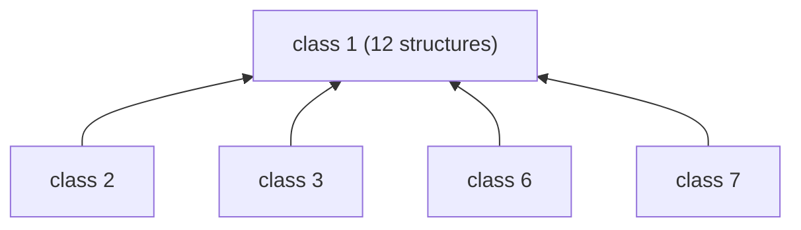
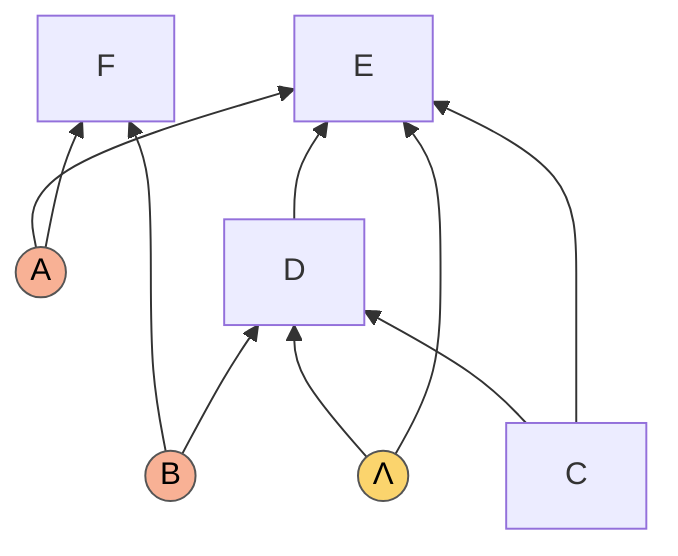
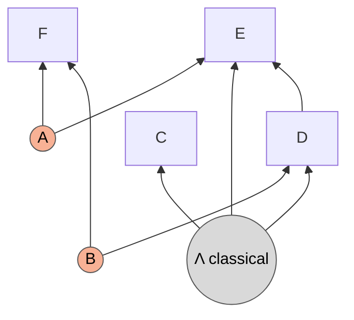
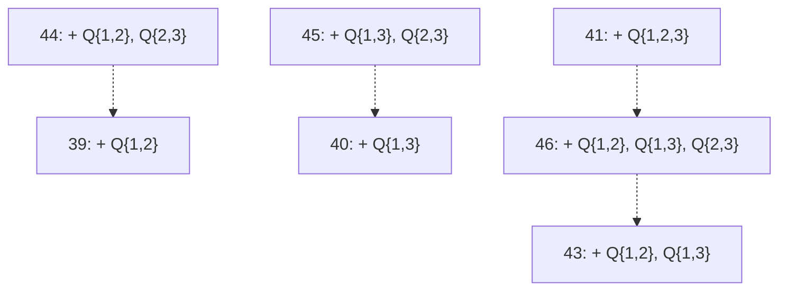

# The 46 open classes: what would follow from what

*A working record for directing effort at the four-node classes the census leaves open. Class numbers are those of the list in Section 10 of [`piggybacks.md`](piggybacks.md) (reprinted in 1.2 below); section numbers such as 6.5 refer to that manuscript. Every count is printed by [`Special Applications/open_classes_analysis.py`](../Special%20Applications/open_classes_analysis.py); see Section 4. Structures are written as edges, then sources: `Q{a,b}` is a quantum source shared by nodes a and b, `C{...}` a classical one.*

## Summary

The question (Roger Colbeck): tell the code that one open class has a gap, see which other open classes it then proves, repeat for all 46. Is there a hierarchy, and a smaller set of key structures?

1. **There is a hierarchy, and it is small.** Exactly one open class has others hanging on it. If **class 1** had a gap, **classes 2, 3, 6 and 7** would follow: 5 classes, 16 of the 61 open structures. Class 1 is the KPC structure with one more source, shared by $D$ and $E.$ No other open class would prove any other.
2. **Two families of hybrid structures would each settle several classes.** A hybrid has some of its sources classical. The KPC structure with a *classical* source shared by $C,$ $D$ and $E$ would settle classes 1, 2, 3, 6 and 7; a hybrid of the structure `0→1, 1→2, 1→3` would settle classes 4 and 5, which do not piggyback onto each other. Section 1.4 lists them.
3. **Everything else stands alone.** The open classes reduce, by the piggybacks, to 15,057 structures. All but 1,474 of them provably have no gap, and among the rest the only structures reached from more than one class are the two families above. 39 classes share nothing with any other.
4. **A second Fritz step does not help.** Given to the cascade as inputs, none of the 94 intermediates that are neither degradations nor provably gap-free is proven.

| Target | Settles | Status |
|---|---|---|
| a gap for **class 1** (KPC plus a source on $D$ and $E$) | classes 1, 2, 3, 6, 7 (16 structures) | open; the KPC argument fails on it (1.3) |
| a gap for KPC with a **classical** source on $C,$ $D,$ $E,$ for instance `2→3; C{1,2,3}, Q{0,2}, Q{0,3}` | the same five classes | open; a weaker structure than class 1, so harder (1.4) |
| a gap for the hybrid `0→1, 1→2, 1→3; C{0,1,2}, C{0,1,3}, Q{0,2}, Q{0,3}` | classes 4 and 5 | open (1.4) |
| a gap for the Evans structure with **one** source classical | class 5 | open in the literature as far as the seed list records (1.4) |

Section 3 records a separate question that the hierarchy does not need: which *classical* equivalences, if they could be proven, would tie open classes together.

## 1. The proof hierarchy

### 1.1 The experiment, and why the recorded graph answers it

The census records every transition it finds: a labelled edge from a structure (or class) to the structure a piggyback produces, meaning *a gap of the target is a gap of the source*. For a class that stays unproven, nothing is cut short: every elementary reduction of every member, closed over everything reachable, and every Fritz step of every member in all nine stages, each followed by the elementary reductions (9.1). So "which classes would be proven if class $i$ were known" is a question about this graph, and it has the same answer as rerunning the census with class $i$ as an extra seed, since a rerun explores a subset of what is already recorded.

The script does the experiment literally: for each of the 46 classes it rebuilds the report with that class added to the known gaps and lists the open classes that become proven (46 reports, 15 seconds), and checks that this agrees with reachability in the graph.

Two limits carry over from the census. The Fritz step is applied once per input ("depth one"); Section 1.6 tests what a second depth adds. And a hypothesis "class $i$ has a gap" is about the all-quantum structures of the class; it says nothing about their degradations, which are weaker.

### 1.2 Result



An arrow $x\to y$ reads "a gap of $y$ would prove $x$". These four are the only relations among the 46.

| From | Steps to class 1 |
|---|---|
| class 2 | one Fritz step by d-separation (node 2 predicted by node 0, split target, unsplit predictor); the output `1→3, 2→3; C{1,2}, Q{0,2}, Q{0,3}, Q{2,3}` is a member of class 1 once its classical source is made quantum, which is free here (0.5) |
| class 3 | parent-predictor Fritz step (2 predicted by its parent 1, split target, split predictor), then point distribution on the copy; lands on `1→2, 2→3; Q{0,2}, Q{0,3}, Q{1,2,3}` |
| class 6 | parent-predictor Fritz step (3 predicted by its parent 2), then point distribution; lands on `1→3, 2→3; Q{0,2}, Q{0,3}, Q{1,2,3}` |
| class 7 | parent-predictor Fritz step (2 predicted by its parent 1), then point distribution; lands on `1→2, 1→3, 2→3; Q{0,2}, Q{0,3}, Q{1,2,3}` |

<details><summary>The 46 open classes (number, structures in the class, representative)</summary>

| | structures | representative |
|---|---|---|
| 1 | 12 | 2→3; Q{0,2}, Q{0,3}, Q{1,2,3} |
| 2 | 1 | 2→3; Q{0,2}, Q{0,3}, Q{1,2}, Q{1,3}, Q{2,3} |
| 3 | 1 | 1→2, 2→3; Q{0,2}, Q{0,3}, Q{1,2}, Q{1,3} |
| 4 | 1 | 0→1, 1→2, 1→3; Q{0,2}, Q{0,3} |
| 5 | 1 | 0→1, 1→2, 1→3; Q{0,2}, Q{0,3}, Q{1,3} |
| 6 | 1 | 1→3, 2→3; Q{0,1}, Q{0,3}, Q{1,2}, Q{2,3} |
| 7 | 1 | 1→2, 1→3, 2→3; Q{0,2}, Q{0,3}, Q{1,2}, Q{1,3} |
| 8 | 1 | 0→3, 1→2; Q{0,1}, Q{0,2}, Q{1,2,3} |
| 9 | 1 | 0→3, 1→2; Q{0,1}, Q{0,2,3}, Q{1,2,3} |
| 10 | 1 | 0→3, 1→2; Q{0,1}, Q{0,2}, Q{0,3}, Q{1,2,3} |
| 11 | 1 | 0→3, 1→2; Q{0,1}, Q{0,2}, Q{1,3}, Q{2,3} |
| 12 | 1 | 0→3, 1→2; Q{0,1}, Q{0,2}, Q{1,2}, Q{1,3}, Q{2,3} |
| 13 | 1 | 0→3, 1→2; Q{0,1}, Q{0,2}, Q{0,3}, Q{1,2}, Q{1,3}, Q{2,3} |
| 14 | 5 | 0→2, 1→2, 2→3; Q{0,1}, Q{1,3} |
| 15 | 1 | 0→1, 1→2, 2→3; Q{0,2}, Q{0,3}, Q{1,2,3} |
| 16 | 1 | 0→1, 1→2, 2→3; Q{0,2}, Q{0,3}, Q{1,3} |
| 17 | 1 | 0→1, 1→2, 2→3; Q{0,1}, Q{0,2}, Q{0,3}, Q{1,2,3} |
| 18 | 1 | 0→1, 1→2, 2→3; Q{0,2}, Q{0,3}, Q{1,2}, Q{1,3} |
| 19 | 1 | 0→1, 1→2, 2→3; Q{0,1}, Q{0,2}, Q{0,3}, Q{1,3} |
| 20 | 1 | 0→1, 1→2, 2→3; Q{0,2}, Q{0,3}, Q{1,3}, Q{2,3} |
| 21 | 1 | 0→1, 1→2, 2→3; Q{0,1}, Q{0,2}, Q{0,3}, Q{1,2}, Q{1,3} |
| 22 | 1 | 0→1, 1→2, 2→3; Q{0,1}, Q{0,2}, Q{0,3}, Q{1,3}, Q{2,3} |
| 23 | 1 | 0→1, 1→2, 2→3; Q{0,2}, Q{0,3}, Q{1,2}, Q{1,3}, Q{2,3} |
| 24 | 1 | 0→1, 1→2, 2→3; Q{0,1}, Q{0,2}, Q{0,3}, Q{1,2}, Q{1,3}, Q{2,3} |
| 25 | 1 | 0→3, 1→2, 2→3; Q{0,1}, Q{0,2}, Q{1,2,3} |
| 26 | 1 | 0→3, 1→2, 2→3; Q{0,1}, Q{0,2,3}, Q{1,2,3} |
| 27 | 1 | 0→3, 1→2, 2→3; Q{0,1}, Q{0,2}, Q{1,3} |
| 28 | 1 | 0→3, 1→2, 2→3; Q{0,1}, Q{0,2,3}, Q{1,3} |
| 29 | 1 | 0→3, 1→2, 2→3; Q{0,1}, Q{0,2}, Q{0,3}, Q{1,2,3} |
| 30 | 1 | 0→3, 1→2, 2→3; Q{0,1}, Q{0,2}, Q{1,2}, Q{1,3} |
| 31 | 1 | 0→3, 1→2, 2→3; Q{0,1}, Q{0,2,3}, Q{1,2}, Q{1,3} |
| 32 | 1 | 0→3, 1→2, 2→3; Q{0,1}, Q{0,2}, Q{1,3}, Q{2,3} |
| 33 | 1 | 0→3, 1→2, 2→3; Q{0,1}, Q{0,2}, Q{0,3}, Q{1,3} |
| 34 | 1 | 0→3, 1→2, 2→3; Q{0,1}, Q{0,2}, Q{1,2}, Q{1,3}, Q{2,3} |
| 35 | 1 | 0→3, 1→2, 2→3; Q{0,1}, Q{0,2}, Q{0,3}, Q{1,2}, Q{1,3} |
| 36 | 1 | 0→3, 1→2, 2→3; Q{0,1}, Q{0,2}, Q{0,3}, Q{1,3}, Q{2,3} |
| 37 | 1 | 0→3, 1→2, 2→3; Q{0,1}, Q{0,2}, Q{0,3}, Q{1,2}, Q{1,3}, Q{2,3} |
| 38 | 1 | 0→1, 1→2, 1→3, 2→3; Q{0,2}, Q{0,3} |
| 39 | 1 | 0→1, 1→2, 1→3, 2→3; Q{0,2}, Q{0,3}, Q{1,2} |
| 40 | 1 | 0→1, 1→2, 1→3, 2→3; Q{0,2}, Q{0,3}, Q{1,3} |
| 41 | 1 | 0→1, 1→2, 1→3, 2→3; Q{0,2}, Q{0,3}, Q{1,2,3} |
| 42 | 1 | 0→1, 1→2, 1→3, 2→3; Q{0,2}, Q{0,3}, Q{2,3} |
| 43 | 1 | 0→1, 1→2, 1→3, 2→3; Q{0,2}, Q{0,3}, Q{1,2}, Q{1,3} |
| 44 | 1 | 0→1, 1→2, 1→3, 2→3; Q{0,2}, Q{0,3}, Q{1,2}, Q{2,3} |
| 45 | 1 | 0→1, 1→2, 1→3, 2→3; Q{0,2}, Q{0,3}, Q{1,3}, Q{2,3} |
| 46 | 1 | 0→1, 1→2, 1→3, 2→3; Q{0,2}, Q{0,3}, Q{1,2}, Q{1,3}, Q{2,3} |

</details>

### 1.3 The hub: KPC with one more source

In the labels of the KPC structure ($F=0,$ $C=1,$ $D=2,$ $E=3;$ sources $A=\lbrace E,F\rbrace,$ $B=\lbrace D,F\rbrace;$ edges $C\to D,$ $C\to E,$ $D\to E$) one of the twelve members of class 1 is

`1→2, 1→3, 2→3; Q{0,2}, Q{0,3}, Q{2,3}`,

the KPC structure with an additional source shared by $D$ and $E.$ The other eleven are its quantum-equivalent variants: the extra source may include $C,$ and then some or all of $C$'s edges may be dropped. The four classes hanging on class 1 are neighbours of it: class 7 is KPC with sources on $\lbrace C,D\rbrace$ and $\lbrace C,E\rbrace$ instead, and classes 2, 3 and 6 replace some of the edges among $C,$ $D,$ $E$ by two-party sources.



The new source is $\Lambda$ (yellow). The KPC argument stops here because Lemma 1 of the paper uses the d-separation $E\perp B\mid CD.$ With the new source the path $E\leftarrow\Lambda\to D\leftarrow B$ is opened by conditioning on $D,$ and the d-separation fails. The census tries the corresponding step ($E$ predicted by $F,$ which now has to delete the new source too) and neither the semigraphoid closure nor the LP certifies it. The steps it does certify on this structure lead nowhere known.

So the single most valuable new result would be a gap for KPC with a source on $D$ and $E$: it decides 16 of the 61 open structures, and it is one latent away from a structure whose gap is understood.

### 1.4 Hybrid structures that would settle several classes

A hybrid structure has some of its sources classical. An open class may fail to reach another class and still reduce, by the piggybacks, to a hybrid that another class reduces to as well. A gap for such a hybrid settles every class that reaches it. Among the structures the open classes reduce to, after the screening of 1.5, hybrids reached from two or more classes come in exactly two families.

**Classes 1, 2, 3, 6 and 7: the KPC structure with a classical source on $C,$ $D$ and $E.$** In the labels of 1.3 ($F=0,$ $C=1,$ $D=2,$ $E=3$) the simplest member is

`2→3; C{1,2,3}, Q{0,2}, Q{0,3}`,

the two KPC sources, the edge $D\to E,$ and a classical source shared by $C,$ $D$ and $E$ in place of the edges out of $C.$



It is the representative of class 1 with its three-way source made classical, so a gap for it is a gap for class 1 by the degradation piggyback (0.4), and classes 2, 3, 6 and 7 follow as in 1.2. Being a degradation, it is a weaker structure than class 1 and no easier to prove. Its interest is that it isolates the question: does the KPC gap survive when $C,$ $D$ and $E$ share classical randomness? It is also an output of the proven KPC structure itself (a parent-predictor Fritz step), so it sits between a structure whose gap is understood and the five open classes.

<details><summary>The fourteen four-node hybrids of this family</summary>

Each is reached from all five classes. They differ in which edges among $C,$ $D,$ $E$ are present and in further quantum sources among them; the classical source `C{1,2,3}` is common to all.

| hybrid |
|---|
| `2→3; C{1,2,3}, Q{0,2}, Q{0,3}` |
| `1→3, 2→3; C{1,2,3}, Q{0,2}, Q{0,3}` |
| `1→3, 2→3; C{1,2,3}, Q{0,2}, Q{0,3}, Q{1,2}` |
| `1→3, 2→3; C{1,2,3}, Q{0,2}, Q{0,3}, Q{1,2}, Q{2,3}` |
| `1→2, 2→3; C{1,2,3}, Q{0,2}, Q{0,3}, Q{1,3}` |
| `1→2, 2→3; C{1,2,3}, Q{0,2}, Q{0,3}, Q{1,3}, Q{2,3}` |
| `1→2, 1→3, 2→3; C{1,2,3}, Q{0,2}, Q{0,3}` |
| `1→2, 1→3, 2→3; C{1,2,3}, Q{0,2}, Q{0,3}, Q{1,2}` |
| `1→2, 1→3, 2→3; C{1,2,3}, Q{0,2}, Q{0,3}, Q{1,3}` |
| `1→2, 1→3, 2→3; C{1,2,3}, Q{0,2}, Q{0,3}, Q{2,3}` |
| `1→2, 1→3, 2→3; C{1,2,3}, Q{0,2}, Q{0,3}, Q{1,2}, Q{2,3}` |
| `1→2, 1→3, 2→3; C{1,2,3}, Q{0,2}, Q{0,3}, Q{1,3}, Q{2,3}` |
| `1→2; C{1,2,3}, Q{0,1}, Q{0,2}, Q{1,2}` |
| `1→2, 3→2; C{1,2,3}, Q{0,1}, Q{0,2}, Q{1,2}` |

Five five-node hybrids are shared by the same classes as well, for instance `1→2, 1→3, 2→3, 4→3; C{0,2,4}, Q{0,2}, Q{0,3}, Q{2,3}`. In all, the five classes share 523 structures that are not provably gap-free; 54 of them are more than degradations registered as lookups, and the strongest is class 1 itself.

</details>

**Classes 4 and 5: three hybrids of `0→1, 1→2, 1→3`.** Class 5 is class 4 with a source added on $\lbrace 1,3\rbrace,$ and neither piggybacks onto the other. Both reduce to

* `1→2, 1→3; C{0,1,2}, C{0,1,3}, Q{0,2}, Q{0,3}` (from each class by a parent-predictor Fritz step: node 1 predicted by its parent 0, unsplit target, split predictor);
* `0→1, 1→2, 1→3; C{0,1,2}, C{0,1,3}, Q{0,2}, Q{0,3}` and its five-node parent `0→1, 1→2, 1→3, 4→2, 4→3; C{0,1,2,4}, C{0,1,3,4}, Q{0,2}, Q{0,3}` (the same step with a split target).

A gap in any of the three settles both classes. These are the only structures the two classes share.

**Hybrids that would settle one class.** Three classes have small hybrid targets of their own.

* **Class 5** reduces, by marginalizing node 0, to `0→1, 0→2; C{0,1}, Q{0,2}`: the Evans structure with one source classical. The seed list takes the Evans structure as a gap only with both sources quantum ([`known_QC_gaps.py`](../known_QC_gaps.py): "with one source classical it is not known to have a gap and is not a seed"). A gap for it, by any argument, proves class 5 at once. It is the cleanest external target in this document: three visible nodes and a question of independent interest.
* **Class 14** (five structures) has fifteen four-node hybrid outputs, for instance `0→2, 1→2, 2→3; C{0,1,2}, Q{1,3}`. Its three-node output `0→1, 1→2; C{1,2}, Q{0,1}` looks like a target and is not one: it is gap-free by the third criterion of 1.5.
* **Class 2** has one: `2→3; C{0,2,3}, Q{0,2}, Q{0,3}, Q{1,2}, Q{1,3}, Q{2,3}`.

### 1.5 Below the class level: what the open classes reduce to

The open classes reach 15,057 structures; none is a known gap, by definition of open. Most cannot be targets, because they provably have no gap:

| visible nodes | reached | no quantum source | classically equivalent to a latent-free DAG | every quantum source equivalent to a classical one | **not provably gap-free** |
|---|---|---|---|---|---|
| 3 | 93 | 17 | 74 | 1 | **1** |
| 4 | 13,628 | 20 | 12,541 | 10 | **1,057** |
| 5 | 1,336 | 0 | 915 | 5 | **416** |

The second criterion uses the classical metagraphs, the five-node one included (a structure classically equivalent to a latent-free DAG has $\mathcal Q=\mathcal C,$ 0.6). The third is the pre-measurement argument of 0.5 read backwards: a quantum source all of whose members but one have no parent and no other source is the same as a classical source.

The screening matters. Before it, five-node Fritz outputs look like promising common targets: 775 of them are reached from two or more classes, some from nine (classes 38 to 46). Outside the two families of 1.4, every one of them (398 structures) is classically equivalent to a latent-free DAG, so it has no gap and proves nothing.

Of the 1,474 survivors, 1,334 are degradations that the search registers as lookups: structures weaker than something else on the list, never easier to prove. The other 140 are the 46 classes themselves and 94 of their outputs. Survivors reached from two or more open classes are exactly the two families of 1.4: 523 structures for classes 1, 2, 3, 6 and 7, and six for classes 4 and 5.

The remaining **39 classes share no candidate with any other class**. For each of them the only structures it reduces to, apart from provably gap-free ones, are its own Fritz outputs and degradations.

### 1.6 A second Fritz depth

The census applies the Fritz step once per input. To test whether that is what keeps the open classes open, the 94 intermediates that are neither degradations nor provably gap-free (one with three nodes, 34 with four, 59 with five) were given to the full cascade as inputs, with the seeds and the 388 further structures the census proves all counting as known, and outputs bounded at five visible nodes. **None is proven** (17 seconds). Within the piggybacks we have, the open classes are open at depth two as well.

### 1.7 The isolated classes, by family

Grouped by their directed edges, the open classes are a handful of families that differ only in which sources sit on a fixed skeleton:

| edges of the representative | classes |
|---|---|
| 2→3 | 1, 2 |
| 1→2, 2→3 | 3 |
| 0→1, 1→2, 1→3 | 4, 5 |
| 1→3, 2→3 | 6 |
| 1→2, 1→3, 2→3 | 7 |
| 0→3, 1→2 | 8 to 13 |
| 0→2, 1→2, 2→3 | 14 |
| 0→1, 1→2, 2→3 | 15 to 24 |
| 0→3, 1→2, 2→3 | 25 to 37 |
| 0→1, 1→2, 1→3, 2→3 | 38 to 46 |

Within a family no member piggybacks onto another. The relations that do exist inside families are the conditional ones of Section 3.3.

## 2. Where to put effort

1. **KPC with a source on $D$ and $E$ (class 1).** Five classes, 16 structures, and a known proof one source away. What has to be replaced is the d-separation $E\perp B\mid CD.$ The hybrid of 1.4, with the extra source classical and shared with $C,$ asks the same question in its barest form.
2. **Evans with one classical source.** Three visible nodes, a question of independent interest, and class 5 follows by one marginalization. If the answer is no, class 5 needs another route, and that is worth knowing too.
3. **The hybrids shared by classes 4 and 5.** Two classes for one proof.
4. **The rest.** 39 classes, each standing alone: for these the piggybacks reduce nothing to anything shared, and each needs either a new piggyback or its own construction. The classical equivalences of Section 3 could tie some of them together, at the price of proving a classical statement first.

## 3. A separate question: classical equivalences

Nothing above depends on this section. It asks a different question from Roger's: which equivalences between causal structures, if they could be established, would make one open class a consequence of another? The answer is that only *new classical* equivalences can help, and the section records which ones are not excluded.

### 3.1 What an equivalence can buy

Three facts turn equivalences into gap transfers.

* **Quantum equivalence** ($\mathcal Q$ and $\mathcal C$ both equal) merges two classes into one problem. The census already counts by proven quantum classes (1.0).
* **The upward rule** (0.6): if $r$ is structurally above $b$ (more edges or sources) then $\mathcal Q(r)\supseteq\mathcal Q(b)$ for free; if in addition $\mathcal C(r)=\mathcal C(b),$ a gap of $b$ is a gap of $r.$ Only the *classical* equivalence has to be proven.
* **Upgrading a source for free**: if a hybrid $H$ has the same quantum model as a structure $U$ obtained by making some of its classical sources quantum, then a gap of $U$ is a gap of $H$ ($\mathcal C(H)=\mathcal C(U)$ always). The proven instance is the rule of 0.5: a classical source may be made quantum when all of its members but one have no parent and no other source.

### 3.2 Classical equivalences the metagraph already has: nothing to gain

One might hope that a classical equivalence which is not known to be quantum-valid, such as an uncertified HLP edge (1.0: 648 classical HLP edges against 528 certified quantumly), would merge an open class into a proven one if it were shown to hold quantumly. It cannot. Of the 396 classical classes on four nodes:

| quantum classes inside | classical classes | status of every quantum class inside |
|---|---|---|
| 1 | 20 | latent-free equivalent |
| 1 | 308 | proven |
| 1 | **46** | **open** |
| 2 | 12 | proven |
| 3 | 5 | proven |
| 4 | 2 | proven |
| 5 | 2 | proven |
| 7 | 1 | proven |

Every open class is the only quantum class of its classical class. The 42 splits the quantum rules introduce all lie inside classical classes that are entirely proven. Showing more HLP edges quantum-valid would tidy the proven part of the census and leave the 46 untouched. Any equivalence that helps has to be one the classical metagraph does not have.

### 3.3 New classical equivalences, through the upward rule

The classical classes of the metagraph are *proven* equivalences; two different classes may still be equal in truth. Take every pair ($r$ an open structure, $b$ a structure structurally below it) and ask whether $\mathcal C(r)=\mathcal C(b)$ can be excluded. Since $r$ is above $b,$ $\mathcal C(r)\supseteq\mathcal C(b),$ and a single support compatible with $r$ and not with $b$ excludes it. The tests, in order: skeleton and d-separations, e-separations and densely connected pairs, then the infeasible supports of binary variables with 2 to 7 events.

| pairs | $b$ in a proven class | $b$ in another open class |
|---|---|---|
| structurally comparable | 3,129 | 392 |
| same skeleton and d-separations | 259 | 230 |
| same e-separations and densely connected pairs | 259 | 229 |
| same infeasible supports, 2 events | 42 | 229 |
| 3 events | 41 | 149 |
| 4 events | 31 | 70 |
| 5 events | 31 | 40 |
| 6 events | 1 | 25 |
| 7 events | **0** | **25** |

A separating support is a proof of inequivalence. A pair that survives is only untested further: binary supports are a weak instrument, as the seven hard graphs below show.

**Against the proven classes: ruled out.** The pairs that survive longest are the natural ones: classes 1, 3, 6 and 7 sit above members of the KPC class, which is proven, and class 2 above another proven class, and through 5 events nothing separates them. Six events do (117 infeasible supports for the class 1 structures against 147 for KPC), and seven events separate the last pair, class 6 above the KPC-class member `1→3, 2→3; Q{0,1}, Q{0,3}, Q{1,2}` (222 against 230). So the extra sources of these classes are not classically redundant, and no open class can be proven by showing it classically equal to a proven structure below it.

**Among the open classes: 24 pairs of classes survive the binary tests** (25 pairs of structures; class 1 meets class 7 through two of its members). Fifteen of them lie inside one family, for which the binary tests carry no information and a published result decides most of the pairs. Nine are of another kind.

*The seven hard graphs.* Classes 39, 40, 41, 43, 44, 45 and 46 are the structure `0→1, 1→2, 1→3, 2→3; Q{0,2}, Q{0,3}` with further sources among nodes 1, 2 and 3. They are the seven mDAGs singled out in Khanna, Ansanelli, Pusey and Wolfe, *Classifying causal structures: ascertaining when classical correlations are constrained by inequalities* ([arXiv:2308.02380](https://arxiv.org/abs/2308.02380), Remark 47 and Section 5): the only four-node mDAGs, among those not shown algebraic, for which no support over binary variables is classically incompatible. For these seven the table above is therefore silent by construction, and we do not rely on it. What is known comes from that paper.

| | classes | extra sources | what the paper shows |
|---|---|---|---|
| Table 2 of the paper | 39, 40, 44, 45 | $\lbrace 1,2\rbrace;$ $\lbrace 1,3\rbrace;$ $\lbrace 1,2\rbrace,\lbrace 2,3\rbrace;$ $\lbrace 1,3\rbrace,\lbrace 2,3\rbrace$ | the seven-event support of its Eq. (17), with node 0 ternary, is incompatible with all four: each has inequality constraints |
| Table 3 of the paper | 41, 43, 46 | $\lbrace 1,2,3\rbrace;$ $\lbrace 1,2\rbrace,\lbrace 1,3\rbrace;$ $\lbrace 1,2\rbrace,\lbrace 1,3\rbrace,\lbrace 2,3\rbrace$ | no incompatible support found at any cardinality tried, that one included; the Shannon cones of the classical model and of the conditional-independence model coincide; whether these three have any inequality constraint is open |

So the seven are provably **not** one classical class: the support that is incompatible with the four is compatible with the three, and every one of the ten pairs between the two groups is classically inequivalent. Five of the fifteen pairs remain:



A dashed arrow $x\to y$ reads "if $\mathcal C(x)=\mathcal C(y),$ a gap of $y$ proves $x$". Two remarks on the group of three. First, if classes 41, 43 and 46 turn out to have no inequality constraints at all, their classical models are equal (each is the full conditional-independence model, here every distribution), and none of them has a gap: for these three the first question is not which gap argument to use but whether there is anything to violate. Second, the support itself is stored in [`Special Applications/the_7_hard_graphs.py`](../Special%20Applications/the_7_hard_graphs.py) as `advanced_support`; its fifth event is $(1,1,0,1),$ where Eq. (17) of the arXiv version prints $(1,1,0,0).$

*A two-party source on an edge.* In the other nine pairs the upper class is the lower one plus a single two-party source placed on an existing visible edge:

| upper | lower | the extra source |
|---|---|---|
| 1 | 7 | Q{2,3} on 2→3 (in the member `1→2, 1→3, 2→3; Q{0,2}, Q{0,3}, Q{1,2}, Q{1,3}, Q{2,3}`) |
| 10 | 8 | Q{0,3} on 0→3 |
| 17 | 15 | Q{0,1} on 0→1 |
| 21 | 18 | Q{0,1} on 0→1 |
| 24 | 23 | Q{0,1} on 0→1 |
| 29 | 25 | Q{0,3} on 0→3 |
| 31 | 28 | Q{1,2} on 1→2 |
| 35 | 30 | Q{0,3} on 0→3 |
| 37 | 34 | Q{0,3} on 0→3 |

The metagraph removes a source $\lbrace a,b\rbrace$ on an edge $a\to b$ only when $a$ has no other parent (0.6). Here $a$ has one, so the rule does not apply, yet no binary support through 7 events tells the two structures apart. The lesson of the seven hard graphs applies: a larger alphabet may separate them, and none has been tried. A proof that such a source is classically redundant in these nine cases would make eight classes consequences of others. The pair (1, 7) is special: class 7 already follows from class 1 by piggyback (1.2), so the classical equivalence would make them equivalent as problems.

*Counting.* With the four piggyback relations of 1.2, 42 problems are independent. If all fourteen remaining classical equivalences hold, the twelve upper classes 10, 17, 21, 24, 29, 31, 35, 37, 41, 44, 45 and 46 follow from lower ones, leaving **30**. These are open questions, not conjectures we have reason to believe. Their value is that each is a purely classical statement about two explicit structures.

### 3.4 Upgrading a classical source for free

A hybrid is a candidate for this when its all-quantum upgrade is a proven class. Among the structures the open classes reach, that happens for 39 hybrids, reached from classes 4, 5 and 14 only. Showing that the classical sources of one of them can be made quantum without enlarging the quantum model, an extension of that rule of 0.5, would give it a gap.

| reached from | hybrid | its all-quantum upgrade (proven) |
|---|---|---|
| 4 and 5 | `0→1, 1→2, 1→3; C{0,1,2}, C{0,1,3}, Q{0,2}, Q{0,3}` | `0→1, 1→2, 1→3; Q{0,1,2}, Q{0,1,3}` |
| 4 and 5 | `1→2, 1→3; C{0,1,2}, C{0,1,3}, Q{0,2}, Q{0,3}` | `1→2, 1→3; Q{0,1,2}, Q{0,1,3}` |
| 5 | `0→1, 0→2; C{0,1}, Q{0,2}` | `0→1, 0→2; Q{0,1}, Q{0,2}` (Evans) |
| 5 | `0→1, 0→2, 3→1, 3→2; C{0,1,3}, C{0,2,3}, Q{0,2}` | `0→1, 0→2, 3→1, 3→2; Q{0,1,3}, Q{0,2,3}` |
| 14 | fifteen hybrids, e.g. `0→2, 1→2, 2→3; C{0,1,2}, Q{1,3}` | e.g. `0→2, 1→2, 2→3; Q{0,1,2}, Q{1,3}` |

These are the hybrids of 1.4 seen from the other side: there the question was a gap proof for the hybrid, here it is whether the hybrid has the same quantum model as a structure already proven. For the rows of classes 4 and 5 the upgrade enlarges a source as well as recolouring it (the quantum part of `C{0,1,2}` is `Q{0,2}`), so equality of the quantum models is a strong statement and a direct gap proof for the hybrid may be the easier route.

The converse situation, a hybrid that is structurally above a proven structure with the same classical model, would be an immediate proof by the upward rule. There is none among the structures the open classes reach.

## 4. Reproducing

```
python "Special Applications/open_classes_analysis.py" --five --events 7
```

The census takes 20 seconds, the hierarchy 15, the five-node metagraph behind the screening of 1.5 three minutes and 3.2 GB (`--five`; without it the five-node intermediates are reported unscreened), the second depth 20 seconds, and the supports test of 3.3 about 8 minutes through 6 events and about 12 more for the seventh (`--events`, default 4). Parts 1 to 4 of the output correspond to Sections 1.2, 1.4 with 1.5, 1.6 and 3.
